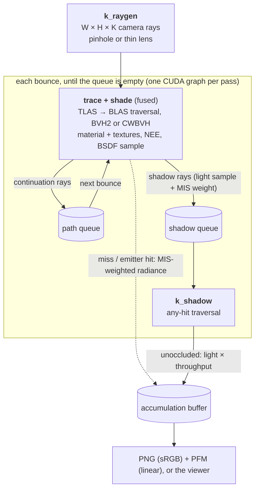

<div align="center">

# cuda-wavefront-pathtracer

**A from-scratch wavefront path tracer that does all BVH traversal on plain CUDA cores.**<br>
Built for GPUs without RT cores. On an NVIDIA H800 its diffuse benchmark path renders the same frame **7.6–10.1× faster than Blender Cycles' OptiX backend**,<br>and the two images agree to within 49.9–50.9 dB PSNR. It also has a full material system, textured glTF scenes with instancing, and an interactive viewer.

[](https://developer.nvidia.com/cuda-toolkit)
[](#build)
[-555)](#benchmarks)
[](#why)
[](LICENSE)

[English](README.md) · [简体中文](README.zh-CN.md)


<sub>Left half: this kernel. Right half: Blender Cycles (OptiX). Same mesh, camera, sun, sky and 256 samples per pixel. The seam is invisible because the two estimators agree.</sub>

</div>

---

## Highlights

- **About 8.5 billion rays per second end to end** on an H800 at 512×512 and 8.1 billion at 720p, on a 117k-triangle scene. Every ray is a real traversal through an SAH BVH on CUDA cores.
- **Wavefront architecture.** Up to 256 samples of every pixel are in flight in one pass. Path state lives in structure-of-arrays buffers and queues are compacted with atomic appends. Each frame's kernel sequence is launched as a CUDA graph.
- **A general renderer as well.** OpenPBR-style materials, textures, HDR environment maps, emissive triangles, multiple importance sampling, a thin-lens camera, two-level BVHs with instancing and animation, a GPU BVH builder (H-PLOC) and an interactive viewer.
- **Validated against Cycles.** The benchmark path agrees to 49.9–50.9 dB. The material system is checked sphere by sphere and model by model against Cycles' Principled BSDF, and every sampling routine has a chi-square test. The differences we found are listed, not tuned away. See [Validation](#validation).
- **A documented ablation study.** More than 20 configurations were measured one change at a time, including the ones that made it slower. See [what worked and what didn't](#optimization-log).
- **Few dependencies.** The core renderer needs only CUDA and a C++17 compiler. Assimp and stb (model and texture loading) and the viewer libraries are optional and fetched at configure time.

<a id="why"></a>
## Why this exists

Datacenter GPUs such as the A100, H100 and H800 have no RT cores. On these cards OptiX falls back to software traversal. In our measurements the Cycles OptiX backend was only 0–8% faster than Cycles' own CUDA BVH2 kernel on an H800.

So the question was how much a specialized kernel can extract from the CUDA cores alone. It turned out to be about an order of magnitude more than a general-purpose production renderer for this workload. That makes an otherwise idle ML GPU usable as a path-tracing render node for simple scenes.

The project then grew a general path tracer around the fast kernel, with the feature set of [Nexus](https://github.com/StokastX/Nexus). The fast diffuse path is still there and is unchanged: its benchmark images are byte-identical to the first release.

## Features

| Area | What is implemented |
|---|---|
| Camera | Pinhole or thin lens (field of view, aperture radius, focus distance). Interactive in the viewer, with click-to-focus. |
| Integrator | Wavefront path tracing (Laine et al. 2013): ray generation, a fused trace + shade kernel, a shadow-ray kernel and global work queues. Kernel launches are recorded into a CUDA graph. Persistent threads with dynamic ray fetching (Aila and Laine 2009) are available as an option. |
| BVH | Binned-SAH BVH2. Compressed wide BVH8 with 80-byte nodes (Ylitie et al. 2017), collapsed from the BVH2 by the SAH dynamic program of that paper. A GPU builder that implements H-PLOC (Benthin et al. 2024). |
| Scenes | Two-level BVH: a bottom level (BLAS) per mesh and a top level (TLAS) over instances. Many instances of one mesh, per-frame transforms for animation, and the TLAS rebuilt on the GPU every frame. |
| Loading | obj, ply, fbx and gltf/glb through Assimp; built-in OBJ/PLY loaders that need no dependency. |
| Materials | An OpenPBR subset with GGX microfacets (Walter et al. 2007). Dielectric base: glossy-diffuse (a non-physical mix of diffuse and specular, with optional energy compensation) and translucent rough dielectric (no volume scattering). Metallic base: rough conductor with the F82-tint model (Kutz et al. 2021). |
| Textures | Base color, emission, normal, metallic and roughness maps (glTF metallic-roughness), as CUDA texture objects. |
| Lights | Emissive triangles sampled by power, an HDR environment map with importance sampling, a sun and a constant sky. |
| Sampling | Cosine-weighted diffuse sampling; visible-normal sampling of GGX with spherical caps (Heitz 2018; Dupuy and Benyoub 2023); next-event estimation combined with BSDF sampling by the power heuristic (Veach 1997); optional Russian roulette. |
| Viewer | GLFW + OpenGL + Dear ImGui. Progressive display, WASD + mouse camera, material, lighting and lens panels, file dialogs and screenshots. |
| Beyond Nexus | A matched validation against Blender Cycles 4.2 with the scripts in `tests/`; chi-square and white-furnace tests of every BSDF; a batch CLI that prints JSON statistics per frame; the ablation log below. |

<p align="center"></p>
<p align="center"><sub>The material test scene: diffuse, rough conductor, rough glass, glossy-diffuse and emissive spheres under a CC0 studio HDRI (Poly Haven). 1024 spp.</sub></p>

<p align="center"></p>
<p align="center"><sub>A two-level scene: 4 meshes in 11 instances (rotated, non-uniformly scaled and two mirrored). The vase and the cat are CC0 Poly Haven glTF models with texture and normal maps. 1024 spp.</sub></p>

## Benchmarks

<p align="center"></p>

These are the published numbers of the diffuse benchmark path (first release, commit `7e41082`).

| Scene | Resolution | This kernel | Cycles OptiX | Cycles CUDA | Speedup vs OptiX | PSNR vs Cycles |
|---|---|---|---|---|---|---|
| 116,855 triangles | 512×512 | **21.5 ms** · 8,506 Mrays/s | 203 ms · ≈897 Mrays/s | 214 ms | **9.5×** | 50.86 dB |
| 116,855 triangles | 1280×720 | **91.5 ms** · 8,106 Mrays/s | 924 ms · ≈803 Mrays/s | 960 ms | **10.1×** | 49.93 dB |
| 2,804,474 triangles | 512×512 | **30.1 ms** · 6,086 Mrays/s | 232 ms · ≈787 Mrays/s | 250 ms | **7.7×** | 50.85 dB |
| 2,804,474 triangles | 1280×720 | **137.2 ms** · 5,407 Mrays/s | 1,048 ms · ≈708 Mrays/s | 1,115 ms | **7.6×** | 49.93 dB |

**Re-measured with this release.** Same card model, same scene and the same configuration, with the binary of this release (timed 2026-10-17). All four rows are within −0.1% to +2.3% of the published throughput, and the images match Cycles as before.

| Scene | Resolution | This release | vs published Mrays/s | PSNR vs Cycles |
|---|---|---|---|---|
| 116,855 triangles | 512×512 | **21.0 ms** · 8,704 Mrays/s | 1.023× | 50.86 dB |
| 116,855 triangles | 1280×720 | **89.8 ms** · 8,258 Mrays/s | 1.019× | 49.94 dB |
| 2,804,474 triangles | 512×512 | **30.1 ms** · 6,078 Mrays/s | 0.999× | 50.85 dB |
| 2,804,474 triangles | 1280×720 | **136.9 ms** · 5,418 Mrays/s | 1.002× | 49.93 dB |

<details>
<summary><b>How these numbers were measured</b> (click to expand)</summary>

**Hardware and software.** NVIDIA H800 80 GB (Hopper, sm_90, no RT cores), driver 535, CUDA 12.4, `nvcc -O3 --use_fast_math`. Blender 4.2.23 LTS. The GPU was in a shared server, and another tenant's idle 20 GB process stayed resident during every measurement.

**Scene.** Six CC0 models from [Poly Haven](https://polyhaven.com) on a ground plane, giving 116,855 triangles. The "2.8M" variant subdivides every model twice; its shape is unchanged. The scene is open and outdoors, and paths are shallow at 2.7–3.1 rays per sample. The scene files are not redistributed here.

**Matched settings.** Both renderers used the same exported PLY mesh, camera and per-material albedo, Lambertian (Diffuse BSDF) materials only, and flat normals. Lighting was one sun at 3.0 W/m² plus a constant sky of (0.30, 0.38, 0.50). Both used 256 spp, 4 diffuse bounces, no Russian roulette, no clamping, a 1 px box filter, no denoiser and no adaptive sampling.

**This kernel's timing.** Frame time is a CUDA event pair around the whole frame: ray generation, all bounces, shading, queue bookkeeping and host synchronization. It excludes mesh loading and BVH build and upload. There is one 8-spp warm-up and two timed 256-spp frames, and the table reports the first. Configuration: `--variant bvh2 --tri woop --fuse 1 --batch 256`, built with `__launch_bounds__(128,12)` (the default build).

**Cycles timing.** Cycles was timed with a wall clock around `bpy.ops.render.render` on the second render with persistent data on, so its BVH is also reused. This includes Blender's fixed per-frame overhead, which weighs more at 512×512 than at 720p.

**Rays per second.** For this kernel, Mrays/s is the measured count of primary, continuation and shadow rays divided by frame time. For Cycles it is an estimate: samples × rays-per-sample from a CPU replay of the same path logic. That replay matched this kernel's measured ray counts within 0.6%. The speedup column is therefore the same as the frame-time ratio.

**Accuracy.** PSNR is computed on 8-bit sRGB images (clip to [0,1], sRGB transfer function, exposure 0) against the Cycles OptiX render. Both are independent 256-spp Monte Carlo estimates, so about 50 dB is close to the noise floor of the comparison.

</details>

### Full integrator

Materials, textures, environment lighting and MIS, on the validation scenes. Both renderers use the matched settings of the [validation](#validation): 1024 spp, 8 bounces, no Russian roulette, 1 px box filter, the same HDRI. Our frame time is measured as above (`--batch 256`, CUDA graph on). Cycles 4.2 OptiX is timed on the second render with persistent data. PSNR and mean difference compare the two timed renders. For the glTF models the mean is taken over the object's pixels.

| Scene | Resolution | Triangles | This renderer | Cycles OptiX | Speedup | PSNR vs Cycles | Mean luminance, ours vs Cycles |
|---|---|---|---|---|---|---|---|
| Material spheres | 640×256 | 182,400 | **99.0 ms** · 2,485 Mrays/s | 481.4 ms | **4.9×** | 42.36 dB | −0.02% (image) |
| Brass vase (glTF, textured) | 512×512 | 21,440 | **102.2 ms** · 3,257 Mrays/s | 368.2 ms | **3.6×** | 46.65 dB | −0.29% (object) |
| Concrete cat (glTF, textured) | 512×512 | 11,950 | **134.1 ms** · 2,803 Mrays/s | 543.4 ms | **4.1×** | 41.17 dB | +5.17% (object) |
| Instanced scene (11 instances) | 640×256 | 215,852 in 4 meshes | **389.6 ms** · 1,089 Mrays/s | 1,592 ms | **4.1×** | 34.62 dB | +0.24% (image) |

With materials and textures the speedup over Cycles OptiX is 3.6–4.9×, about half of the diffuse benchmark's. The +5.2% of the concrete cat is the model difference explained under [Validation](#validation).

<p align="center"></p>
<p align="center"><sub>The instanced scene from the table. Left half: this renderer (390 ms). Right half: Cycles OptiX (1.59 s). Both 1024 spp.</sub></p>

### BVH build: H-PLOC on the GPU vs binned SAH on the CPU

| Mesh | Layout | CPU binned SAH (1 thread) | H-PLOC on the GPU (+ host post-processing) | SAH cost, CPU / H-PLOC |
|---|---|---|---|---|
| 2,804,474 triangles | BVH2 | 6,199 ms | 1.74 ms (+322 ms) | 6.959 / 2.686 |
| 2,804,474 triangles | CWBVH | 8,558 ms | 1.74 ms (+404 ms) | 1.336 / 1.336 |
| synthetic, 2,020,400 triangles | BVH2 | 4,161 ms | 1.29 ms (+226 ms) | 50.669 / 55.179 |
| synthetic, 2,020,400 triangles | CWBVH | 5,874 ms | 1.29 ms (+290 ms) | 15.511 / 17.212 |

H-PLOC time is the GPU time of Morton codes, sort and clustering. Post-processing is the download and the host-side leaf optimisation (BVH2) or wide collapse (CWBVH). H-PLOC trees trace as fast as SAH trees on the 2.8M-triangle mesh but 4–9% slower on the synthetic scene, where their SAH cost is 9–11% higher. So the CPU SAH builder stays the default for static meshes, and H-PLOC builds the TLAS every frame and is available with `--builder hploc`.

### Kernel launch modes (full integrator, material spheres)

| Mode | ms per frame | Mrays/s | vs default |
|---|---|---|---|
| CUDA graph, fused kernels (default) | 98.8 ms | 2,491 | 1.00 |
| Host launch loop | 95.8 ms | 2,569 | 1.03 |
| CUDA graph + persistent threads | 120.2 ms | 2,046 | 0.82 |
| Host loop + persistent threads | 116.8 ms | 2,106 | 0.85 |

All four modes produce bitwise-identical images at `--batch 1`. At `--batch 256` a pass has few, large kernel launches, and here the host loop was 3% faster than the graph. The graph was made the default after an earlier same-session comparison at batch 64 and 4 on a shared GPU, where it gained 1.43× in geometric mean; it helps most when passes are small. Persistent threads were 15–18% slower on this scene.

> [!IMPORTANT]
> This is a specialized kernel compared with a general production renderer on a workload chosen to match it. The speedup shows what a focused wavefront design can extract from CUDA cores. It does not mean this code replaces Cycles. The gap will shrink with textured or glossy materials, many lights, and long indoor paths. On GPUs **with** RT cores, hardware OptiX traversal should be far faster than anything in this repo; we have not measured that.

## How it works



- **Two integrators.** The legacy integrator is the fast Lambert + sun + sky path that the benchmarks use. The full integrator adds the material system, textures, emissive triangles, the environment map and MIS. `--integrator auto` picks the full one only when the scene needs it, so diffuse scenes keep the fast kernel.
- **BVH2.** A CPU binned-SAH builder with 16 bins and at most 4 triangles per leaf. In the GPU layout each 64-byte node stores both children's boxes, following Aila & Laine (2009). Traversal uses a 64-entry stack in local memory and visits the nearer child first.
- **CWBVH.** An 8-wide BVH with 80-byte nodes and 8-bit quantized child boxes (Ylitie et al. 2017). The BVH2 is collapsed by the SAH-optimal dynamic program of the same paper. It is slower than BVH2 on the shallow diffuse benchmark (see the log below).
- **H-PLOC.** A GPU builder from the paper of Benthin et al. (2024): adaptive 64-bit Morton codes, a radix sort, then hierarchical nearest-neighbour clustering in one kernel. It builds a 2–3 M triangle mesh in about 4 ms of GPU time.
- **Two-level scenes.** Every mesh has its own BLAS. The TLAS over the instances is rebuilt by H-PLOC on every frame, which takes about 0.05 ms for 11 instances. Rays are transformed into object space at the instance leaf. Normals use the inverse transpose, tangents the forward matrix, and mirrored instances flip the orientation by the sign of the determinant.
- **Triangles.** Woop's unit-triangle transform is the default in the fast configuration. It stores 3 `float4` per triangle in leaf order and rejects on t first. Möller–Trumbore is also available.
- **Materials and sampling.** See [Materials](#materials) for the model. Each path vertex takes one light sample (sun, emissive triangle by power, or environment texel by luminance × sin θ) and one BSDF sample, combined by the power heuristic.
- **Environment map.** Equirectangular Radiance `.hdr`, sampled from a 2D CDF over its texels. At equal sample count this lowered the per-pixel variance by 4.2× on the material scene compared with uniform sphere sampling.
- **Wavefront.** `--batch K` launches K·W·H paths per pass. With K = 1 a 512×512 frame has only 262k rays per bounce, far too few for the 132 SMs of an H800. Going to K = 64 (16.8 M paths in flight) gives 12–17× more throughput with BVH2, and the gains continue up to K = 256.
- **CUDA graphs and persistent threads.** For the full integrator the sequence of kernels in one pass, with device-side queue counts, is captured once and replayed as a graph. This is the default; it pays off most for small batches (see the [launch-mode table](#kernel-launch-modes-full-integrator-material-spheres)). `--persistent 1` launches just enough threads to fill the GPU, and threads that finish a ray fetch the next one from the queue. It helps on some scenes only and stays opt-in.
- **Determinism.** Random numbers come from a stateless hash of (pixel, sample, depth, dimension, seed), so every path is reproducible. Pixel accumulation uses float atomics, so runs with `--batch` > 1 can differ in the last bit. With `--batch 1` they are bitwise reproducible.

<a id="validation"></a>
## Validation

Every phase of the feature work was checked by tests that were written down before they were run. The reference is Blender Cycles 4.2 (OptiX) with its Principled BSDF set item by item to our material parameters: GGX, 1024 spp, 8 bounces, no Russian roulette, no clamping, a 1 px box filter, the same CC0 HDRI. The scripts are in `tests/`.

| Check | Result |
|---|---|
| BSDF sampling vs pdf, chi-square, 16 lobe configurations, 2·10⁶ samples each | every p > 0.01 (lowest 0.022) |
| White furnace, roughness 0–1, three angles | conductor (F0 = 1) within 0.14%, dielectric within 0.26%, glossy-diffuse albedo ≤ 1.0003 |
| MIS vs light-only vs BSDF-only sampling, 32 seeds each | same mean in all 16 regions (largest z 2.93) |
| Material spheres vs Cycles, mean luminance per sphere | diffuse −0.05%, conductor −0.18%, rough glass −0.65%, glossy-diffuse +0.21%, emissive +0.01% |
| Five Poly Haven glTF models vs Cycles (textures, normal maps), mean luminance over the object | brass vase −0.29%, concrete cat **+5.17%**, ceramic vase +0.29%, drill +2.21%, game console +2.13% |
| Environment importance sampling vs uniform sampling | same mean (largest z 2.56), 4.2× lower variance |
| Thin lens | aperture 0 is bitwise equal to the pinhole camera; the focal plane is as sharp as the pinhole image; defocus blur within 0.5% of the predicted circle of confusion |
| 11 instances vs the same scene flattened into one mesh | 61.89 dB |
| 30-frame animation vs flattening and rebuilding every frame | every frame ≥ 61.61 dB |
| H-PLOC vs CPU SAH trace speed (median of 15 pairs) | 1.00 and 0.99 on the 2.8M-triangle mesh, 0.91 and 0.96 on the synthetic scene (BVH2, CWBVH) |
| CUDA graph and persistent threads vs host loop and split kernels | bitwise identical images; compute-sanitizer memcheck, racecheck and initcheck clean |
| Viewer vs batch renderer, same seed and samples | linear output bitwise identical (102 dB on the 8-bit images) |
| Diffuse benchmark after every phase | images byte-identical to the first release (50.86 / 49.93 / 50.85 / 49.93 dB vs Cycles) |

What we found and did not tune away:

- **Glossy-diffuse is brighter than Principled v2 at high roughness.** Ours mixes a GGX specular lobe with a Lambert lobe and scales the diffuse weight by the specular albedo. Principled v2 layers them differently. Untextured spheres come out +2.9% at roughness 1.0, +1.0% at 0.5 and +0.2% at 0.3. With `--gd_energy 0` (a plain Fresnel mix) they come out 1–3% darker instead.
- **Cycles darkens bump-mapped diffuse surfaces more.** Cycles applies a bump-terminator shadowing term. We implement it (Chiang et al. 2019) as the opt-in `--bump_shadow 1`; it is off by default.
- These two effects explain the +5.17% of the concrete cat. Its roughness is 0.97 on average. With the specular layer off on both sides and `--bump_shadow 1` the difference drops to +0.44%. With normal maps off on both sides it is +3.15%, where the sphere measurements predict +2.8%.
- **H-PLOC trees trace 4–9% slower on the synthetic scene,** so the CPU SAH builder stays the default for static meshes (see the build table).
- **One nondeterminism bug was found and fixed.** Shading of normal-mapped hits on instances gave different results run to run in the split and persistent kernels. Loading the instance's matrices into registers once fixed it. We believe it was a code-generation issue, but we did not prove that at the instruction level. After the fix, compute-sanitizer memcheck, racecheck and initcheck were clean.
- **Not verified:** a Windows / MSVC build, and the CUDA–OpenGL interop display path on real hardware. Under WSL interop is not supported, and the viewer used its host-copy fallback in every test.

## Viewer

<p align="center"></p>

Build with `-DCWP_WITH_VIEWER=ON` (see [Build](#build)). The viewer takes every option of `pt` and accumulates samples until you change something.

```bash
./build/viewer --mesh model.gltf --env studio.hdr
```

Without `--camera` it frames the scene automatically.

| Input | Action |
|---|---|
| Right mouse drag | Look around |
| W / A / S / D, Q / E | Move; down / up |
| Shift / Alt | Move 5× faster / 5× slower |
| Mouse wheel | Change the move speed |
| Middle click, or Ctrl + left click | Focus the thin lens at the cursor |
| P | Save a screenshot (PNG) |
| Ctrl + O | Open a model or scene file |

The panels set exposure and tone mapping (clip, Reinhard, ACES fit), field of view, aperture and focus distance, the sun, the environment strength and rotation, and the material parameters. Changes restart the accumulation.

For scripts and tests: `--frames N --screenshot out.png --exit` renders N frames, saves the image and quits. With `--batch 1` the image is bitwise equal to `pt --spp N`. Other options: `--passes P` (batch passes per displayed frame), `--interop auto|0|1`, `--exposure EV`, `--tonemap clip|reinhard|aces`, `--win_width`, `--win_height`, `--hide_ui 1`, `--screenshot_pfm` (linear output).

<a id="optimization-log"></a>
## Optimization log

Each step changed one thing on top of the current best configuration. A step was kept only if the geometric mean of end-to-end Mrays/s over the four benchmark rows improved by at least 3% and PSNR against Cycles stayed at or above 49 dB. These steps were measured on the diffuse benchmark path.

| Step | Change | Effect | Kept |
|---|---|---|:-:|
| 1 | Batch K = 1 → 64 samples per pixel in flight | 12–17× at 512×512 (BVH2) | ✅ |
| 2 | Batch K = 64 → 128 | +6.0% | ✅ |
| 3 | **Fuse closest-hit traversal and shading into one kernel** | **+28.8%** | ✅ |
| 4 | Woop unit-triangle test instead of Möller–Trumbore, re-measured on the fused kernel | +3.1% | ✅ |
| 5 | `__launch_bounds__(128,12)`: at most 40 registers, 75% occupancy | +3.0% | ✅ |
| 6 | Batch K = 128 → 256: the whole frame in one wavefront pass | +4.8% | ✅ |
| — | Persistent-thread traversal kernels | 2–8% slower | ❌ |
| — | Device-driven bounce loop with no host synchronization | −7.9% | ❌ |
| — | Sorting bounce rays into 32,768 bins by direction octant and origin Morton code | −30%: traversal gained at most 2% and the sort cost more | ❌ |
| — | BVH4 with 128 B nodes, on the fused kernel | −17.7% | ❌ |
| — | Compressed 8-wide BVH | −19.3%: decoding 8 child boxes costs more ALU than it saves in bandwidth on shallow paths | ❌ |
| — | Tracing the shadow ray inline in the fused kernel, with no shadow queue | −9.1%: one thread runs two traversals in series and warp divergence grows | ❌ |
| — | Leaves of at most 2 triangles | +1.7% | ❌ |
| — | Leaves of at most 8 triangles | −7.2% | ❌ |
| — | At most 32 registers (100% occupancy, spills) | −2% to −26% | ❌ |

Steps 2–6 together are 1.43–1.58× faster than the K = 64 baseline with separate trace and shade kernels and Möller–Trumbore triangles. That baseline was already 4.9–6.5× faster than Cycles OptiX.

For the full integrator, the CUDA graph became the default after a same-session comparison on three test scenes: 1.43× faster in geometric mean and never below 0.998×. Persistent threads were faster on one scene and much slower on another, so they stay opt-in.

## Build

You need the CUDA toolkit (nvcc), a C++17 host compiler and CMake 3.22 or newer. Building does not need a GPU. `build.sh` is a thin wrapper around CMake; if CMake is not installed it falls back to calling nvcc directly (without Assimp and the viewer).

```bash
git clone https://github.com/YJLi-new/cuda-wavefront-pathtracer.git
```

```bash
cd cuda-wavefront-pathtracer && ./build.sh
```

The build targets `sm_90` by default. For other GPUs set `ARCH`, for example `ARCH=sm_80 ./build.sh` for an A100 or `ARCH=sm_89 ./build.sh` for an RTX 40-series card. Only sm_90 has been tuned and tested. `ASSIMP=OFF ./build.sh` builds without network access. `VARIANTS=1 ./build.sh` also builds the register-cap variants used in the ablation.

With CMake directly, including the viewer:

```bash
cmake -S . -B build -DCMAKE_CUDA_ARCHITECTURES=90 -DCWP_WITH_VIEWER=ON && cmake --build build -j
```

| CMake option | Default | Meaning |
|---|---|---|
| `CMAKE_CUDA_ARCHITECTURES` | 90 | GPU architecture (`ARCH=sm_XX` in `build.sh`) |
| `CWP_WITH_ASSIMP` | ON | Assimp model loading and stb_image textures. OFF builds offline with the built-in OBJ/PLY loaders. |
| `CWP_WITH_VIEWER` | OFF | Build `build/viewer` (GLFW, GLEW, Dear ImGui, tinyfiledialogs) |
| `CWP_VIEWER_WAYLAND` | OFF | Also build GLFW's Wayland backend (Linux) |
| `CWP_MINB` | 12 | `__launch_bounds__(128, MINB)` of the traversal kernels; 0 = no register cap |
| `CWP_VARIANTS` | OFF | Also build `pt_nocap` and `pt_mb16` from the ablation |
| `CWP_TESTS` | ON | Build `cwp_bsdf_tests` (chi-square and white-furnace tests on the CPU; run with `ctest`) |
| `FETCHCONTENT_SOURCE_DIR_<NAME>` | — | Use a local copy of a dependency instead of downloading it. `<NAME>` is `ASSIMP`, `STB`, `GLFW`, `GLEW`, `IMGUI` or `TINYFILEDIALOGS`. With all of them set, add `-DFETCHCONTENT_FULLY_DISCONNECTED=ON` for a fully offline build. |

The viewer on Linux needs the X11 and OpenGL development headers (libx11, libxrandr, libxinerama, libxcursor, libxi, libxext, libgl). It was built on Ubuntu 22.04 and run under WSLg on Ubuntu 24.04. A Windows / MSVC build has not been tested.

### Dependencies

The core renderer uses only the CUDA runtime. Everything else is optional and fetched by CMake at a pinned version.

| Library | Version | Used for | Licence | Needed by |
|---|---|---|---|---|
| [Assimp](https://github.com/assimp/assimp) | v5.4.3 | obj, ply, fbx, gltf/glb loading | BSD-3-Clause | `CWP_WITH_ASSIMP` (default on) |
| [stb](https://github.com/nothings/stb) (stb_image) | commit `2c980bb` | PNG / JPEG textures | MIT or public domain (your choice) | `CWP_WITH_ASSIMP` |
| [GLFW](https://www.glfw.org) | 3.4 | window, OpenGL context, input | zlib | viewer |
| [GLEW](https://github.com/nigels-com/glew) | 2.2.0 | OpenGL loader | modified BSD, with MIT parts (Mesa, Khronos) | viewer |
| [Dear ImGui](https://github.com/ocornut/imgui) | v1.91.9b | user interface | MIT | viewer |
| [tinyfiledialogs](https://sourceforge.net/projects/tinyfiledialogs/) | commit `db67fa7` | open / save dialogs | zlib | viewer |

Each licence was checked against the licence text in the fetched source. None of these libraries is copied into this repository.

## Run

The built-in synthetic scene has about 2.0 M triangles: a ground plane and a 7×7 grid of bumpy spheres.

```bash
./build/pt --synthetic 7 --width 1280 --height 720 --spp 256 --bounces 4 --variant bvh2 --tri woop --fuse 1 --batch 64 --out out/synthetic
```

<p align="center"></p>

Render your own mesh. The example scene is in `examples/`:

```bash
./build/pt --mesh examples/boxes.obj --camera examples/camera.json --lighting examples/lighting.json --width 960 --height 540 --spp 256 --bounces 4 --tri woop --fuse 1 --batch 64 --out out/boxes
```

<p align="center"></p>

The material scene above, with any equirectangular `.hdr` file (for example a CC0 HDRI from Poly Haven):

```bash
python tests/material_spheres.py out/spheres studio.hdr
./build/pt --mesh out/spheres/spheres.obj --materials out/spheres/materials.json --camera out/spheres/camera.json --lighting out/spheres/lighting.json --width 640 --height 256 --spp 1024 --batch 64 --variant bvh2 --tri woop --fuse 1 --out out/spheres
```

A glTF model with its textures, lit by an HDRI (`--yup_to_zup` is automatic for glTF):

```bash
./build/pt --mesh model.gltf --env studio.hdr --camera camera.json --width 512 --height 512 --spp 1024 --batch 64 --out out/model
```

A scene file with instances and animation (format [below](#scene-files)); `--frames 30` writes `out/anim_f0000.png` … `out/anim_f0029.png`:

```bash
./build/pt --scene scene.json --camera camera.json --lighting lighting.json --frames 30 --variant bvh8 --out out/anim
```

Run the benchmark preset at 512×512 and 1280×720:

```bash
BATCH=64 scripts/bench_synthetic.sh
```

Each run prints one JSON line to stdout with ray counts, `t_frame_ms`, `t_trace_ms`, `mrays_s_e2e`, `mrays_s_trace`, BVH statistics (including build times and SAH cost) and memory use. It writes `<out>.png` (sRGB, exposure 0, clipped) and `<out>.pfm` (linear radiance). To compare two renders, run `python tools/psnr.py a.png b.png`; this needs numpy and Pillow.

> [!TIP]
> **Memory.** Each path in flight of the diffuse path needs about 128 bytes, so memory is about 128 × width × height × batch bytes plus the scene. At 720p that is about 7 GB for `--batch 64`, 14 GB for 128 and 29 GB for 256. A larger batch is faster until the GPU is saturated. `--spp` must be a multiple of `--batch`.

### Command-line options

| Option | Default | Meaning |
|---|---|---|
| `--mesh PATH` | — | `.obj` (with `.mtl` `Kd` colours, optional `vn` normals) or `.ply` (ASCII or binary little-endian, optional `nx ny nz`, optional per-face `material_index`); with Assimp also `.fbx`, `.gltf`, `.glb` |
| `--scene PATH` | — | Scene file with several meshes and instances, described below. Replaces `--mesh`. |
| `--synthetic N` | 0 | Built-in scene with N×N spheres, about 40k triangles each. Replaces `--mesh` and `--camera`. |
| `--loader auto\|builtin\|assimp` | auto | `auto` uses the built-in loader for OBJ/PLY and Assimp for the rest |
| `--camera PATH` | — | Camera JSON, described below |
| `--c2w "m00,m01,…,m33"` | — | Camera-to-world matrix given directly: 16 numbers, row-major |
| `--c2w_key KEY` / `--frame I` | `c2w_blender_zup` / 0 | Which matrix in the camera JSON to use. The key may hold one matrix or a list of per-frame matrices. |
| `--width`, `--height` | 512, 512 | Image size |
| `--hfov DEG` / `--fx`, `--fy` | 50° | Horizontal field of view, or focal length in pixels |
| `--aperture R`, `--focus_dist D` | camera file, else pinhole | Thin lens: aperture radius and focus distance in scene units. 0 = pinhole. |
| `--spp N` | 256 | Samples per pixel |
| `--batch K` | 64 | Samples per pixel in flight per wavefront pass |
| `--bounces N` | 8 | Maximum bounces. The camera hit is depth 0. |
| `--variant bvh2\|bvh4\|bvh8` | bvh2 | BVH layout (bvh8 = CWBVH; bvh4 only for single-level scenes without the CUDA graph) |
| `--builder sah\|hploc` | sah | BLAS builder: CPU binned SAH or GPU H-PLOC. The TLAS always uses H-PLOC. |
| `--collapse sah\|greedy` | sah | BVH2 → CWBVH collapse: SAH dynamic program or the old greedy collapse |
| `--tri mt\|woop` | mt | Triangle test. `woop` is faster. |
| `--fuse 0\|1\|2` | 0 legacy, 1 full | 1 fuses traversal and shading, the fastest setting. 2 also traces the shadow ray inline (legacy only). |
| `--graph 0\|1` | 1 full, 0 legacy | Launch each pass as a CUDA graph (full integrator) |
| `--persistent 0\|1` | 0 | Persistent threads with dynamic ray fetching |
| `--leaf N` | 4 | Maximum triangles per BVH leaf |
| `--frames N`, `--frame_start F` | scene file, 0 | Render N animation frames of a scene file, starting at frame F |
| `--flatten 0\|1` | 0 | Bake all instances into one mesh and a single-level BVH (reference path) |
| `--lighting PATH` | — | Lighting JSON, described below |
| `--sun_to X Y Z` | 0.3 −0.5 0.8 | Direction **toward** the sun, world z-up |
| `--sun_rgb R G B` | 3 3 3 | Sun irradiance on a surface facing the sun, W/m² |
| `--sun_angle DEG` | 0.526 | Angular diameter of the sun |
| `--sky R G B` | 0.3 0.3 0.3 | Constant sky radiance |
| `--albedo R G B` | — | Override every material's albedo |
| `--filter bh\|box` | bh | Pixel filter: Blackman–Harris 1.5 px (as in Cycles) or 1 px box |
| `--smooth 0\|1` | 1 | Use vertex normals if the mesh has them |
| `--yup_to_zup 0\|1` | auto | Convert a y-up mesh to z-up; automatic for glTF |
| `--eps S` | 1e-4 | Ray origin offset as a fraction of the scene extent |
| `--near D` | 0 | Near clip distance for camera rays |
| `--seed`, `--warm`, `--reps` | 1000, 8, 1 | RNG seed, warm-up spp, number of timed frames |
| `--devloop`, `--sort` | 0 | Experimental variants of the legacy path from the ablation study. Both are slower. |
| `--out PREFIX` | out | Output path prefix |
| `--materials PATH` | — | Material JSON (OpenPBR subset), described below |
| `--textures LIST` | all | Texture maps to use: comma-separated subset of `base,emission,normal,metallic,roughness` |
| `--tex_filter linear\|nearest` | linear | Texture filtering |
| `--env PATH` | — | Equirectangular Radiance `.hdr` environment map; replaces the constant sky |
| `--env_strength S`, `--env_rot DEG` | 1, 0 | Environment radiance scale and rotation about world z |
| `--env_sampling importance\|uniform` | importance | How light samples of the environment are drawn |
| `--integrator auto\|legacy\|full` | auto | `legacy` is the fast Lambert + sun + sky path the benchmarks use. `full` adds the material system, textures, emissive triangles, the environment map and MIS. `auto` picks `full` only when the scene needs it. |
| `--light_sampling mis\|nee\|bsdf` | mis | Full integrator: how emitters and the environment are sampled. `mis` combines light and BSDF sampling with the power heuristic. |
| `--rr 0\|1`, `--rr_depth N` | 0, 3 | Full integrator: Russian roulette from depth N (off by default) |
| `--gd_energy 0\|1` | 1 | Full integrator: energy compensation of the glossy-diffuse mix (albedo scaling); 0 = plain Fresnel-weighted mix |
| `--bump_shadow 0\|1` | 0 | Full integrator: bump-terminator shadowing of normal-mapped diffuse shading (Chiang et al. 2019), as Cycles does |

### Input formats

**Camera.** The world is z-up. The camera uses the OpenGL convention: it looks down its −Z axis with +Y up. `c2w` is a row-major 4×4 matrix. If `width` and `height` match the requested resolution, `fx` and `fy` are used. Otherwise the loader falls back to `hfov_deg`, which is read only when `fx` is present. Optional keys `aperture_radius` and `focus_distance` enable the thin lens.

```json
{ "width": 960, "height": 540, "fx": 1158.823, "fy": 1158.823, "hfov_deg": 45.0,
  "c2w_blender_zup": [0.759, -0.201, 0.619, 9.0,  0.651, 0.235, -0.722, -10.5,  0.0, 0.951, 0.309, 5.5,  0, 0, 0, 1] }
```

**Lighting.** Every key is optional.

```json
{ "sun_dir_to_light_world_zup": [0.609, -0.426, 0.669],
  "sun_irradiance_W_m2": 3.0,
  "sun_angle_rad": 0.00918,
  "sky_radiance_rgb_linear": [0.30, 0.38, 0.50],
  "albedo_rgb_linear_by_material_index": [[0.5, 0.5, 0.5], [0.8, 0.35, 0.22]] }
```

If `albedo_rgb_linear_by_material_index` is present it replaces the mesh's material colours, indexed by OBJ material order or PLY `material_index`. The lighting file may also set `"env_map"`, `"env_strength"` and `"env_rotation_deg"`.

<a id="materials"></a>
**Materials.** `--materials` takes a list of OpenPBR-style parameters; every key is optional. An entry whose `name` matches an OBJ `usemtl` name is assigned to that material; other entries are assigned by position (entry *i* is PLY `material_index` *i*). glTF materials are read from the file: base color, metallic and roughness factors and maps, normal map, emission (with `KHR_materials_emissive_strength`), and `KHR_materials_transmission` / `KHR_materials_ior` when present.

```json
{ "materials": [
  { "name": "gold", "base_color": [0.95, 0.64, 0.54], "metallic": 1.0, "roughness": 0.3, "specular_color": [1, 1, 1] },
  { "name": "glass", "base_color": [1, 1, 1], "transmission": 1.0, "roughness": 0.1, "ior": 1.5 },
  { "name": "paint", "base_color": [0.2, 0.4, 0.8], "roughness": 0.4, "ior": 1.5, "specular_weight": 1.0 },
  { "name": "lamp", "base_color": [0.5, 0.5, 0.5], "emission_color": [1.0, 0.6, 0.3], "emission_strength": 3.0 } ] }
```

| Base | When | Model |
|---|---|---|
| Conductor | `metallic` = 1 | GGX microfacet reflection, Schlick Fresnel with the F82 tint term (Kutz et al. 2021), F0 = `base_color`, tint = `specular_color` |
| Translucent dielectric | `transmission` = 1 | Rough GGX reflection and refraction (Walter et al. 2007), exact Fresnel, refraction tinted by `base_color`, no volume scattering |
| Glossy-diffuse | otherwise | GGX dielectric specular (`ior`, `specular_weight`) over a Lambertian `base_color` lobe; a non-physical mix whose diffuse weight is 1 − (specular albedo) |

Fractional `metallic` and `transmission` blend the three bases linearly. `roughness` *r* gives GGX α = *r*². Microfacet lobes are sampled from the distribution of visible normals with the spherical-cap method (Heitz 2018; Dupuy and Benyoub 2023), diffuse lobes with a cosine distribution. Emission is two-sided. Emissive triangles become area lights sampled by power. Each path vertex takes one light sample: sun, emissive triangle or environment texel (luminance × sin θ). This light sample is combined with the BSDF sample by the power heuristic (Veach 1997). A scene whose materials are all plain Lambert, untextured and not emissive, lit by the sun and sky only, still uses the legacy kernels unchanged. Scene files always use the full integrator.

<a id="scene-files"></a>
**Scene files.** `--scene` takes a list of meshes and a list of instances. Paths are relative to the scene file. A mesh may have its own `materials` file. An instance gives either a 3×4 row-major `transform`, or `translate`, `axis` + `angle_deg` and `scale` (a number or three numbers), applied as T·R·S. Animated instances add `translate_per_frame`, `angle_deg_per_frame` and `scale_per_frame`, or list one matrix per frame in `transforms`.

```json
{ "frames": 30,
  "meshes": [ { "file": "spheres.obj", "materials": "materials.json" }, { "file": "vase.gltf" } ],
  "instances": [
    { "mesh": 0, "transform": [1,0,0,0, 0,1,0,0, 0,0,1,0] },
    { "mesh": 1, "translate": [1.25, -2.5, -1.0], "axis": [0,0,1], "angle_deg": 40, "scale": [2.5, 2.5, 1.6] },
    { "mesh": 1, "translate": [4.0, -3.0, -0.75], "scale": [2.0, -2.0, 2.0], "angle_deg_per_frame": 3 } ] }
```

## Limitations

- **Materials.** An OpenPBR subset only (conductor, rough dielectric, glossy-diffuse, emission). There is no coat, sheen, subsurface, thin film or volume. Single-scattering GGX loses energy at high roughness. Glossy-diffuse differs from Principled v2 by up to about 3% at high roughness (see [Validation](#validation)).
- **Lights.** Sun, constant sky or equirectangular `.hdr` environment map, and emissive triangles. There are no point or spot lights. The sun is only light-sampled, so it is not seen through glass or in mirrors.
- **Sampling.** Russian roulette is optional and off by default. There is no adaptive sampling and no denoiser.
- **Geometry.** Triangle meshes only. Animation is per-instance rigid transforms (no skinning or deformation). The CPU SAH builder is single-threaded; build time is excluded from frame times.
- **Viewer.** The CUDA–OpenGL interop path has not been tested on real hardware; under WSL the viewer copies each frame through the host. Windows / MSVC builds are not verified.
- **Portability.** It compiles for any architecture nvcc supports, but it has been tuned and validated only on Hopper (sm_90).
- **Scope of the speedup.** The headline speedup was measured on one open outdoor scene with shallow paths and diffuse materials only. See the note under [Benchmarks](#benchmarks).

## Repository layout

```
src/core/         float3 helpers, hash RNG, sampling warps (host + device, header-only)
src/scene/        mesh, material, camera and lighting types; environment map; tangents; scene files and instances; synthetic scene
src/accel/        binned-SAH BVH2 builder; GPU H-PLOC builder; CWBVH collapse; BVH2/BVH4/CWBVH layouts; triangle packing;
                  single-level and two-level device traversal
src/render/       wavefront kernels (raygen, fused and split trace+shade, persistent trace, shadow), BSDFs, CUDA graph driver
src/io/           OBJ/MTL and PLY loaders; Assimp loader; camera, lighting and JSON files; .hdr reader; PNG and PFM writers
src/app/          pt.cpp (batch renderer CLI, build/pt), viewer.cpp + display.cu (interactive viewer), scene_setup (shared options)
tools/psnr.py     PSNR in tonemapped sRGB (PNG, PFM or EXR inputs)
tests/            CPU BSDF tests (chi-square, white furnace); Cycles reference scripts (OBJ scene, glTF model, scene file);
                  material-sphere, thin-lens and MIS / environment-sampling tests; comparison scripts
scripts/          benchmark preset
examples/         small OBJ scene with camera and lighting JSON
docs/images/      README images
CMakeLists.txt    build (one static library per module; optional Assimp and viewer)
build.sh          wrapper around CMake (ARCH, VARIANTS, ASSIMP)
```

## Acknowledgements

The algorithms follow published work. They were implemented from the papers; no other renderer's source code was used.

- T. Aila and S. Laine, *Understanding the Efficiency of Ray Traversal on GPUs*, HPG 2009.
- S. Laine, T. Karras and T. Aila, *Megakernels Considered Harmful: Wavefront Path Tracing on GPUs*, HPG 2013.
- H. Ylitie, T. Karras and S. Laine, *Efficient Incoherent Ray Traversal on GPUs Through Compressed Wide BVHs*, HPG 2017.
- C. Benthin, D. Meister, J. Barczak, R. Mehalwal, J. Tsakok and A. Kensler, *H-PLOC: Hierarchical Parallel Locally-Ordered Clustering for Bounding Volume Hierarchy Construction*, HPG 2024.
- B. Walter, S. Marschner, H. Li and K. Torrance, *Microfacet Models for Refraction through Rough Surfaces*, EGSR 2007.
- E. Heitz, *Sampling the GGX Distribution of Visible Normals*, JCGT 2018; J. Dupuy and A. Benyoub, *Sampling Visible GGX Normals with Spherical Caps*, HPG 2023.
- A. Kutz et al., *Adobe Standard Material*, technical documentation, 2021, for the F82 tint.
- E. Veach, *Robust Monte Carlo Methods for Light Transport Simulation*, PhD thesis, 1997.
- M. J.-Y. Chiang, Y. K. Li and B. Burley, *Taming the Shadow Terminator*, SIGGRAPH 2019 Talks.
- The [OpenPBR](https://academysoftwarefoundation.github.io/OpenPBR/) specification, and the feature list of [Nexus](https://github.com/StokastX/Nexus).
- S. Woop, *A Ray Tracing Hardware Architecture for Dynamic Scenes*, 2004, for the unit-triangle intersection test.
- T. Möller and B. Trumbore, *Fast, Minimum Storage Ray/Triangle Intersection*, JGT 1997.
- T. Duff et al., *Building an Orthonormal Basis, Revisited*, JCGT 2017.

The benchmark and test scenes use CC0 models and HDRIs from [Poly Haven](https://polyhaven.com). The reference renders were made with [Blender Cycles](https://www.cycles-renderer.org/). This project was developed with the help of Claude (Anthropic).

## License

[MIT](LICENSE)
