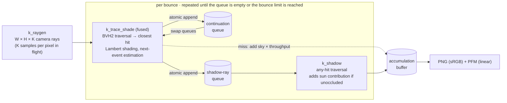

<div align="center">

# cuda-wavefront-pathtracer

**A from-scratch wavefront path tracer that does all BVH traversal on plain CUDA cores.**<br>
Built for GPUs without RT cores. On an NVIDIA H800 it renders the same frame **7.6–10.1× faster than Blender Cycles' OptiX backend**,<br>and the two images agree to within 49.9–50.9 dB PSNR.

[](https://developer.nvidia.com/cuda-toolkit)
[](#build)
[-555)](#benchmarks)
[](#why)
[](LICENSE)

[English](README.md) · [简体中文](README.zh-CN.md)


<sub>Left half: this kernel. Right half: Blender Cycles (OptiX). Same mesh, camera, sun, sky and 256 samples per pixel. The seam is invisible because the two estimators agree.</sub>

</div>

---

## Highlights

- **About 8.5 billion rays per second end to end** on an H800 at 512×512 and 8.1 billion at 720p, on a 117k-triangle scene. Every ray is a real traversal through an SAH BVH on CUDA cores.
- **Wavefront architecture.** Up to 256 samples of every pixel are in flight in one pass. Path state lives in structure-of-arrays buffers and queues are compacted with atomic appends.
- **Fused trace + shade kernel.** Each thread traverses and shades in the same kernel, which removes the hit-buffer round trip. This single change gave +29%.
- **Validated against Cycles.** On a matched configuration the PSNR is 49.9–50.9 dB, and the image means differ by about 0.3%.
- **Small and dependency-free.** About 1,200 lines of CUDA and C++17 with no external libraries. It ships its own OBJ/PLY loaders, BVH builders and PNG/PFM writers.
- **A documented ablation study.** More than 20 configurations were measured one change at a time, including the ones that made it slower. See [what worked and what didn't](#optimization-log).

<a id="why"></a>
## Why this exists

Datacenter GPUs such as the A100, H100 and H800 have no RT cores. On these cards OptiX falls back to software traversal. In our measurements the Cycles OptiX backend was only 0–8% faster than Cycles' own CUDA BVH2 kernel on an H800.

So the question was how much a specialized kernel can extract from the CUDA cores alone. It turned out to be about an order of magnitude more than a general-purpose production renderer for this workload. That makes an otherwise idle ML GPU usable as a path-tracing render node for simple scenes.

## Benchmarks

<p align="center"></p>

| Scene | Resolution | This kernel | Cycles OptiX | Cycles CUDA | Speedup vs OptiX | PSNR vs Cycles |
|---|---|---|---|---|---|---|
| 116,855 triangles | 512×512 | **21.5 ms** · 8,506 Mrays/s | 203 ms · ≈897 Mrays/s | 214 ms | **9.5×** | 50.86 dB |
| 116,855 triangles | 1280×720 | **91.5 ms** · 8,106 Mrays/s | 924 ms · ≈803 Mrays/s | 960 ms | **10.1×** | 49.93 dB |
| 2,804,474 triangles | 512×512 | **30.1 ms** · 6,086 Mrays/s | 232 ms · ≈787 Mrays/s | 250 ms | **7.7×** | 50.85 dB |
| 2,804,474 triangles | 1280×720 | **137.2 ms** · 5,407 Mrays/s | 1,048 ms · ≈708 Mrays/s | 1,115 ms | **7.6×** | 49.93 dB |

<details>
<summary><b>How these numbers were measured</b> (click to expand)</summary>

**Hardware and software.** NVIDIA H800 80 GB (Hopper, sm_90, no RT cores), driver 535, CUDA 12.4, `nvcc -O3 --use_fast_math`. Blender 4.2.23 LTS. The GPU was in a shared server, and another tenant's idle 20 GB process stayed resident during every measurement.

**Scene.** Six CC0 models from [Poly Haven](https://polyhaven.com) on a ground plane, giving 116,855 triangles. The "2.8M" variant subdivides every model twice; its shape is unchanged. The scene is open and outdoors, and paths are shallow at 2.7–3.1 rays per sample. The scene files are not redistributed here.

**Matched settings.** Both renderers used the same exported PLY mesh, camera and per-material albedo, Lambertian (Diffuse BSDF) materials only, and flat normals. Lighting was one sun at 3.0 W/m² plus a constant sky of (0.30, 0.38, 0.50). Both used 256 spp, 4 diffuse bounces, no Russian roulette, no clamping, a 1 px box filter, no denoiser and no adaptive sampling.

**This kernel's timing.** Frame time is a CUDA event pair around the whole frame: ray generation, all bounces, shading, queue bookkeeping and host synchronization. It excludes mesh loading and BVH build and upload. There is one 8-spp warm-up and two timed 256-spp frames, and the table reports the first. Configuration: `--variant bvh2 --tri woop --fuse 1 --batch 256`, built with `__launch_bounds__(128,12)`.

**Cycles timing.** Cycles was timed with a wall clock around `bpy.ops.render.render` on the second render with persistent data on, so its BVH is also reused. This includes Blender's fixed per-frame overhead, which weighs more at 512×512 than at 720p.

**Rays per second.** For this kernel, Mrays/s is the measured count of primary, continuation and shadow rays divided by frame time. For Cycles it is an estimate: samples × rays-per-sample from a CPU replay of the same path logic. That replay matched this kernel's measured ray counts within 0.6%. The speedup column is therefore the same as the frame-time ratio.

**Accuracy.** PSNR is computed on 8-bit sRGB images (clip to [0,1], sRGB transfer function, exposure 0) against the Cycles OptiX render. Both are independent 256-spp Monte Carlo estimates, so about 50 dB is close to the noise floor of the comparison.

</details>

> [!IMPORTANT]
> This is a specialized kernel compared with a general production renderer on a workload chosen to match it. The speedup shows what a focused wavefront design can extract from CUDA cores. It does not mean this code replaces Cycles. The gap will shrink with textured or glossy materials, many lights, and long indoor paths. On GPUs **with** RT cores, hardware OptiX traversal should be far faster than anything in this repo; we have not measured that.

## How it works



- **BVH.** A CPU binned-SAH builder with 16 bins and at most 4 triangles per leaf produces a BVH2. In the GPU layout each 64-byte node stores both children's boxes, following Aila & Laine (2009). Traversal uses a 64-entry stack in local memory and visits the nearer child first. BVH4 (128 B nodes) and a compressed 8-wide BVH (80 B nodes, 8-bit quantized child boxes, in the style of Ylitie et al. 2017) are also implemented. They were slower on this workload.
- **Triangles.** Woop's unit-triangle transform is the default in the fast configuration. It stores 3 `float4` per triangle in leaf order and rejects on t first. Möller–Trumbore is also available.
- **Shading.** Lambertian BRDF and cosine-weighted continuation rays. The sun is sampled by next-event estimation inside a cone of its angular diameter, and a ray that escapes adds the constant sky radiance.
- **Wavefront.** `--batch K` launches K·W·H paths per pass. With K = 1 a 512×512 frame has only 262k rays per bounce, far too few for the 132 SMs of an H800. Going to K = 64 (16.8 M paths in flight) gives 12–17× more throughput with BVH2, and the gains continue up to K = 256.
- **Determinism.** Random numbers come from a stateless hash of (pixel, sample, depth, dimension, seed), so every path is reproducible. Pixel accumulation uses float atomics.

<a id="optimization-log"></a>
## Optimization log

Each step changed one thing on top of the current best configuration. A step was kept only if the geometric mean of end-to-end Mrays/s over the four benchmark rows improved by at least 3% and PSNR against Cycles stayed at or above 49 dB.

| Step | Change | Effect | Kept |
|---|---|---|:-:|
| 1 | Batch K = 1 → 64 samples per pixel in flight | 12–17× at 512×512 (BVH2) | ✅ |
| 2 | Batch K = 64 → 128 | +6.0% | ✅ |
| 3 | **Fuse closest-hit traversal and shading into one kernel** | **+28.8%** | ✅ |
| 4 | Woop unit-triangle test instead of Möller–Trumbore, re-measured on the fused kernel | +3.1% | ✅ |
| 5 | `__launch_bounds__(128,12)`: at most 40 registers, 75% occupancy | +3.0% | ✅ |
| 6 | Batch K = 128 → 256: the whole frame in one wavefront pass | +4.8% | ✅ |
| — | Persistent-thread traversal kernels | 2–8% slower | ❌ |
| — | Device-driven bounce loop with no host synchronization | −7.9% | ❌ |
| — | Sorting bounce rays into 32,768 bins by direction octant and origin Morton code | −30%: traversal gained at most 2% and the sort cost more | ❌ |
| — | BVH4 with 128 B nodes, on the fused kernel | −17.7% | ❌ |
| — | Compressed 8-wide BVH | −19.3%: decoding 8 child boxes costs more ALU than it saves in bandwidth on shallow paths | ❌ |
| — | Tracing the shadow ray inline in the fused kernel, with no shadow queue | −9.1%: one thread runs two traversals in series and warp divergence grows | ❌ |
| — | Leaves of at most 2 triangles | +1.7% | ❌ |
| — | Leaves of at most 8 triangles | −7.2% | ❌ |
| — | At most 32 registers (100% occupancy, spills) | −2% to −26% | ❌ |

Steps 2–6 together are 1.43–1.58× faster than the K = 64 baseline with separate trace and shade kernels and Möller–Trumbore triangles. That baseline was already 4.9–6.5× faster than Cycles OptiX.

## Build

You need the CUDA toolkit (nvcc) and a C++17 host compiler. Building does not need a GPU.

```bash
git clone https://github.com/YJLi-new/cuda-wavefront-pathtracer.git
```

```bash
cd cuda-wavefront-pathtracer && ./build.sh
```

The build targets `sm_90` by default. For other GPUs set `ARCH`, for example `ARCH=sm_80 ./build.sh` for an A100 or `ARCH=sm_89 ./build.sh` for an RTX 40-series card. Only sm_90 has been tuned and tested. `VARIANTS=1 ./build.sh` also builds the register-cap variants used in the ablation.

## Run

The built-in synthetic scene has about 2.0 M triangles: a ground plane and a 7×7 grid of bumpy spheres.

```bash
./build/pt --synthetic 7 --width 1280 --height 720 --spp 256 --bounces 4 --variant bvh2 --tri woop --fuse 1 --batch 64 --out out/synthetic
```

<p align="center"></p>

Render your own mesh. The example scene is in `examples/`:

```bash
./build/pt --mesh examples/boxes.obj --camera examples/camera.json --lighting examples/lighting.json --width 960 --height 540 --spp 256 --bounces 4 --tri woop --fuse 1 --batch 64 --out out/boxes
```

<p align="center"></p>

Run the benchmark preset at 512×512 and 1280×720:

```bash
BATCH=64 scripts/bench_synthetic.sh
```

Each run prints one JSON line to stdout with ray counts, `t_frame_ms`, `t_trace_ms`, `mrays_s_e2e`, `mrays_s_trace`, BVH statistics and memory use. It writes `<out>.png` (sRGB, exposure 0, clipped) and `<out>.pfm` (linear radiance). To compare two renders, run `python tools/psnr.py a.png b.png`; this needs numpy and Pillow.

> [!TIP]
> **Memory.** Each path in flight needs about 128 bytes, so memory is about 128 × width × height × batch bytes plus the scene. At 720p that is about 7 GB for `--batch 64`, 14 GB for 128 and 29 GB for 256. A larger batch is faster until the GPU is saturated. `--spp` must be a multiple of `--batch`.

### Command-line options

| Option | Default | Meaning |
|---|---|---|
| `--mesh PATH` | — | `.obj` (with `.mtl` `Kd` colours, optional `vn` normals) or `.ply` (ASCII or binary little-endian, optional `nx ny nz`, optional per-face `material_index`) |
| `--synthetic N` | 0 | Built-in scene with N×N spheres, about 40k triangles each. Replaces `--mesh` and `--camera`. |
| `--camera PATH` | — | Camera JSON, described below |
| `--c2w "m00,m01,…,m33"` | — | Camera-to-world matrix given directly: 16 numbers, row-major |
| `--c2w_key KEY` / `--frame I` | `c2w_blender_zup` / 0 | Which matrix in the camera JSON to use. The key may hold one matrix or a list of per-frame matrices. |
| `--width`, `--height` | 512, 512 | Image size |
| `--hfov DEG` / `--fx`, `--fy` | 50° | Horizontal field of view, or focal length in pixels |
| `--spp N` | 256 | Samples per pixel |
| `--batch K` | 64 | Samples per pixel in flight per wavefront pass |
| `--bounces N` | 8 | Indirect diffuse bounces. The camera hit is depth 0. |
| `--variant bvh2\|bvh4\|bvh8` | bvh2 | BVH layout |
| `--tri mt\|woop` | mt | Triangle test. `woop` is faster. |
| `--fuse 0\|1\|2` | 0 | 1 fuses traversal and shading, the fastest setting. 2 also traces the shadow ray inline. |
| `--leaf N` | 4 | Maximum triangles per BVH leaf |
| `--lighting PATH` | — | Lighting JSON, described below |
| `--sun_to X Y Z` | 0.3 −0.5 0.8 | Direction **toward** the sun, world z-up |
| `--sun_rgb R G B` | 3 3 3 | Sun irradiance on a surface facing the sun, W/m² |
| `--sun_angle DEG` | 0.526 | Angular diameter of the sun |
| `--sky R G B` | 0.3 0.3 0.3 | Constant sky radiance |
| `--albedo R G B` | — | Override every material's albedo |
| `--filter bh\|box` | bh | Pixel filter: Blackman–Harris 1.5 px (as in Cycles) or 1 px box |
| `--smooth 0\|1` | 1 | Use vertex normals if the mesh has them |
| `--yup_to_zup 0\|1` | 0 | Convert a y-up mesh to z-up |
| `--eps S` | 1e-4 | Ray origin offset as a fraction of the scene extent |
| `--near D` | 0 | Near clip distance for camera rays |
| `--seed`, `--warm`, `--reps` | 1000, 8, 1 | RNG seed, warm-up spp, number of timed frames |
| `--persistent`, `--devloop`, `--sort` | 0 | Experimental variants from the ablation study. All are slower. |
| `--out PREFIX` | out | Output path prefix |

### Input formats

**Camera.** The world is z-up. The camera uses the OpenGL convention: it looks down its −Z axis with +Y up. `c2w` is a row-major 4×4 matrix. If `width` and `height` match the requested resolution, `fx` and `fy` are used. Otherwise the loader falls back to `hfov_deg`, which is read only when `fx` is present.

```json
{ "width": 960, "height": 540, "fx": 1158.823, "fy": 1158.823, "hfov_deg": 45.0,
  "c2w_blender_zup": [0.759, -0.201, 0.619, 9.0,  0.651, 0.235, -0.722, -10.5,  0.0, 0.951, 0.309, 5.5,  0, 0, 0, 1] }
```

**Lighting.** Every key is optional.

```json
{ "sun_dir_to_light_world_zup": [0.609, -0.426, 0.669],
  "sun_irradiance_W_m2": 3.0,
  "sun_angle_rad": 0.00918,
  "sky_radiance_rgb_linear": [0.30, 0.38, 0.50],
  "albedo_rgb_linear_by_material_index": [[0.5, 0.5, 0.5], [0.8, 0.35, 0.22]] }
```

If `albedo_rgb_linear_by_material_index` is present it replaces the mesh's material colours, indexed by OBJ material order or PLY `material_index`.

## Limitations

- **Materials.** Lambertian only, one albedo per material. There are no textures and no glossy, specular or transmissive BSDFs.
- **Lights.** One sun and a constant sky. There is no environment-map importance sampling and there are no area, point or emissive lights.
- **Sampling.** There is no Russian roulette, no adaptive sampling and no denoiser.
- **Geometry.** Static triangle meshes only. The BVH is built single-threaded on the CPU at start-up, and this is excluded from frame times.
- **Portability.** It compiles for any architecture nvcc supports, but it has been tuned and validated only on Hopper (sm_90).
- **Scope of the speedup.** It was measured on one open outdoor scene with shallow paths and diffuse materials only. See the note under [Benchmarks](#benchmarks).

## Repository layout

```
src/main.cu       kernels (raygen, fused trace+shade, shade, shadow) and the host driver
src/bvh.h         binned-SAH BVH2 builder; BVH2 and BVH4 GPU layouts; triangle packing
src/bvh8.h        compressed 8-wide BVH and Woop triangle packing
src/mesh.h        OBJ/MTL and PLY loaders; synthetic scene generator
src/vec.h         float3 helpers
src/png.h         minimal PNG and PFM writers
tools/psnr.py     PSNR in tonemapped sRGB (PNG, PFM or EXR inputs)
scripts/          benchmark preset
examples/         small OBJ scene with camera and lighting JSON
build.sh          build script (ARCH, VARIANTS)
```

## Acknowledgements

The traversal and data layouts follow ideas from published work:

- T. Aila and S. Laine, *Understanding the Efficiency of Ray Traversal on GPUs*, HPG 2009.
- S. Laine, T. Karras and T. Aila, *Megakernels Considered Harmful: Wavefront Path Tracing on GPUs*, HPG 2013.
- H. Ylitie, T. Karras and S. Laine, *Efficient Incoherent Ray Traversal on GPUs Through Compressed Wide BVHs*, HPG 2017.
- S. Woop, *A Ray Tracing Hardware Architecture for Dynamic Scenes*, 2004, for the unit-triangle intersection test.
- T. Möller and B. Trumbore, *Fast, Minimum Storage Ray/Triangle Intersection*, JGT 1997.
- T. Duff et al., *Building an Orthonormal Basis, Revisited*, JCGT 2017.

The benchmark scene uses CC0 models from [Poly Haven](https://polyhaven.com). The reference renders were made with [Blender Cycles](https://www.cycles-renderer.org/). This project was developed with the help of Claude (Anthropic).

## License

[MIT](LICENSE)
