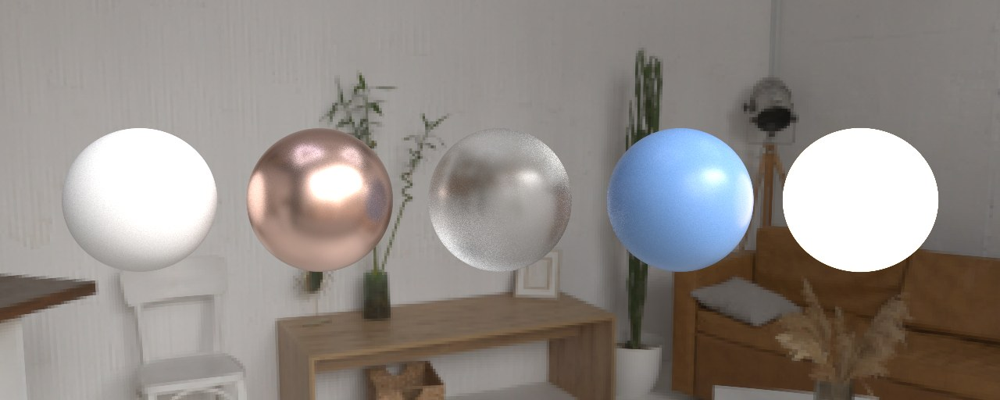
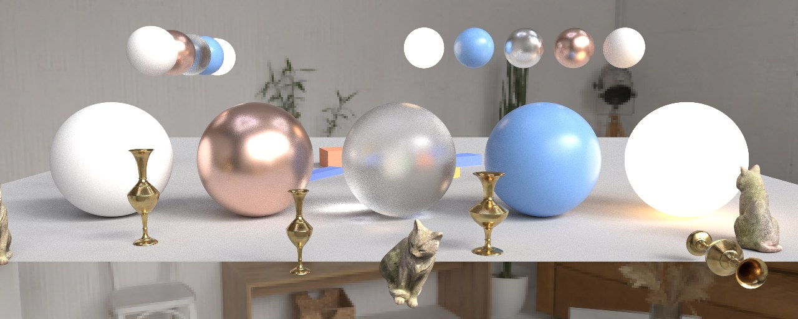
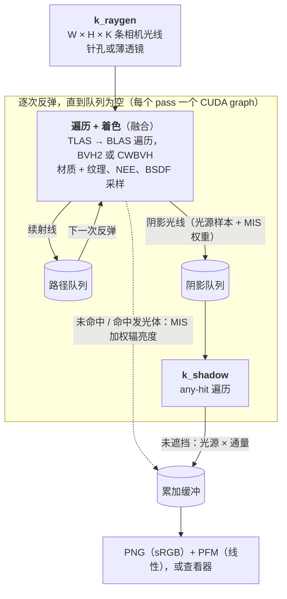
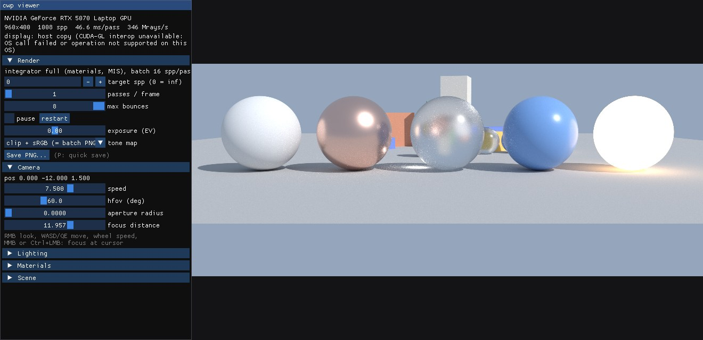

<div align="center">

# cuda-wavefront-pathtracer

**从零编写的 wavefront 路径追踪器，BVH 遍历全部跑在普通 CUDA 核心上。**<br>
为没有 RT 核心的 GPU 而写。在 NVIDIA H800 上，它的漫反射基准路径渲染同一帧**比 Blender Cycles 的 OptiX 后端快 7.6–10.1 倍**，<br>两者图像的 PSNR 为 49.9–50.9 dB。它也有完整的材质系统、带纹理和实例化的 glTF 场景，以及交互式查看器。

[](https://developer.nvidia.com/cuda-toolkit)
[](#构建)
[-555)](#性能)
[](#为什么做这个)
[](LICENSE)

[English](README.md) · [简体中文](README.zh-CN.md)


<sub>左半边：本内核。右半边：Blender Cycles（OptiX）。网格、相机、太阳、天空与每像素 256 个样本完全相同。两个估计量一致，所以看不到接缝。</sub>

</div>

---

## 亮点

- **端到端约 85 亿条光线每秒**：H800 上 117k 三角形场景，512×512 为 8.5 G rays/s，720p 为 8.1 G rays/s。每条光线都真实遍历一棵 SAH BVH，全部在 CUDA 核心上完成。
- **Wavefront 架构**：一次 pass 中每个像素最多有 256 个样本同时在飞。路径状态存成结构数组，队列用原子追加压缩。每帧的内核序列以 CUDA graph 发射。
- **同时也是通用渲染器**：OpenPBR 风格材质、纹理、HDR 环境贴图、自发光三角形、多重重要性采样、薄透镜相机、支持实例化与动画的两级 BVH、GPU BVH 构建器（H-PLOC）和交互式查看器。
- **与 Cycles 对照验证**：基准路径的 PSNR 为 49.9–50.9 dB。材质系统逐个材质球、逐个模型地与 Cycles 的 Principled BSDF 对照，每个采样函数都有卡方检验。发现的差异都列出来了，没有调参凑数。见[验证](#验证)。
- **完整的消融记录**：每次只改一项，测了 20 多个配置，变慢的也都记下来了。见[优化记录](#优化记录)。
- **依赖少**：核心渲染器只需要 CUDA 和 C++17 编译器。Assimp 与 stb（模型和纹理读取）以及查看器用到的库都是可选的，在配置时下载。

## 为什么做这个

A100、H100、H800 这类数据中心 GPU 没有 RT 核心，OptiX 在这些卡上退化为软件遍历。我们实测 H800 上 Cycles 的 OptiX 后端只比它自己的 CUDA BVH2 内核快 0–8%。

所以问题是：专门写的内核单靠 CUDA 核心能榨出多少性能？在这类负载上，结果比通用生产渲染器高出约一个数量级。这样一来，原本闲着的机器学习 GPU 也能作为简单场景的路径追踪渲染节点。

之后项目在这个快速内核外面长出了一个通用路径追踪器，功能对齐 [Nexus](https://github.com/StokastX/Nexus)。快速的漫反射路径仍然保留且没有改动：它的基准图像与第一版逐字节相同。

## 功能

| 方面 | 已实现 |
|---|---|
| 相机 | 针孔或薄透镜（视场角、光圈半径、对焦距离）。在查看器中可交互调整，可点击对焦。 |
| 积分器 | Wavefront 路径追踪（Laine 等 2013）：光线生成、融合的遍历 + 着色内核、阴影光线内核和全局工作队列。内核发射录制成 CUDA graph。可选持久线程加动态取光线（Aila 与 Laine 2009）。 |
| BVH | 分箱 SAH 的 BVH2。80 字节节点的压缩宽 BVH8（Ylitie 等 2017），由 BVH2 按该论文的 SAH 动态规划塌缩而成。实现 H-PLOC（Benthin 等 2024）的 GPU 构建器。 |
| 场景 | 两级 BVH：每个网格一棵底层 BLAS，实例之上一棵顶层 TLAS。同一网格可有多个实例，逐帧变换支持动画，TLAS 每帧在 GPU 上重建。 |
| 读取 | 通过 Assimp 读 obj、ply、fbx、gltf/glb；另有无依赖的内置 OBJ/PLY 读取器。 |
| 材质 | OpenPBR 子集，GGX 微表面（Walter 等 2007）。介电基底：glossy-diffuse（漫反射与镜面的非物理混合，可选能量补偿）和透射粗糙介电（无体散射）。金属基底：带 F82-tint 模型（Kutz 等 2021）的粗糙导体。 |
| 纹理 | 基础色、自发光、法线、金属度、粗糙度贴图（glTF metallic-roughness），用 CUDA 纹理对象。 |
| 光源 | 按功率采样的自发光三角形、带重要性采样的 HDR 环境贴图、太阳和常数天空。 |
| 采样 | 漫反射余弦加权采样；GGX 可见法线采样（球冠法，Heitz 2018；Dupuy 与 Benyoub 2023）；下一事件估计与 BSDF 采样用幂启发式组合（Veach 1997）；可选俄罗斯轮盘。 |
| 查看器 | GLFW + OpenGL + Dear ImGui。渐进显示，WASD + 鼠标控制相机，材质、光照与镜头面板，文件对话框和截图。 |
| Nexus 之外 | 用 `tests/` 中的脚本与 Blender Cycles 4.2 做对齐验证；每个 BSDF 的卡方与白炉测试；每帧打印 JSON 统计的批渲染命令行；下面的消融记录。 |

<p align="center"></p>
<p align="center"><sub>材质测试场景：漫反射、粗糙导体、粗糙玻璃、glossy-diffuse 和自发光球，光照为 CC0 的摄影棚 HDRI（Poly Haven）。1024 spp。</sub></p>

<p align="center"></p>
<p align="center"><sub>两级场景：4 个网格、11 个实例（旋转、非均匀缩放，其中两个是镜像）。花瓶和猫是带纹理与法线贴图的 CC0 Poly Haven glTF 模型。1024 spp。</sub></p>

## 性能

<p align="center"></p>

以下是漫反射基准路径的发布值（第一版，提交 `7e41082`）。

| 场景 | 分辨率 | 本内核 | Cycles OptiX | Cycles CUDA | 相对 OptiX 加速 | 对 Cycles 的 PSNR |
|---|---|---|---|---|---|---|
| 116,855 三角形 | 512×512 | **21.5 ms** · 8,506 Mrays/s | 203 ms · ≈897 Mrays/s | 214 ms | **9.5×** | 50.86 dB |
| 116,855 三角形 | 1280×720 | **91.5 ms** · 8,106 Mrays/s | 924 ms · ≈803 Mrays/s | 960 ms | **10.1×** | 49.93 dB |
| 2,804,474 三角形 | 512×512 | **30.1 ms** · 6,086 Mrays/s | 232 ms · ≈787 Mrays/s | 250 ms | **7.7×** | 50.85 dB |
| 2,804,474 三角形 | 1280×720 | **137.2 ms** · 5,407 Mrays/s | 1,048 ms · ≈708 Mrays/s | 1,115 ms | **7.6×** | 49.93 dB |

**用本版本重测**：同型号的卡、同一场景、同一配置，换成本版本的二进制（2026-10-17 计时）。四行吞吐与发布值相差 −0.1% 到 +2.3%，对 Cycles 的图像一致性与之前相同。

| 场景 | 分辨率 | 本版本 | 相对发布值 Mrays/s | 对 Cycles 的 PSNR |
|---|---|---|---|---|
| 116,855 三角形 | 512×512 | **21.0 ms** · 8,704 Mrays/s | 1.023× | 50.86 dB |
| 116,855 三角形 | 1280×720 | **89.8 ms** · 8,258 Mrays/s | 1.019× | 49.94 dB |
| 2,804,474 三角形 | 512×512 | **30.1 ms** · 6,078 Mrays/s | 0.999× | 50.85 dB |
| 2,804,474 三角形 | 1280×720 | **136.9 ms** · 5,418 Mrays/s | 1.002× | 49.93 dB |

<details>
<summary><b>测量方法</b>（点击展开）</summary>

**软硬件**：NVIDIA H800 80 GB（Hopper，sm_90，无 RT 核心），驱动 535，CUDA 12.4，`nvcc -O3 --use_fast_math`；Blender 4.2.23 LTS。GPU 位于共享服务器上，每次测量时都有另一个租户约 20 GB 的空闲进程驻留。

**场景**：地面上放 6 个 [Poly Haven](https://polyhaven.com) 的 CC0 模型，共 116,855 个三角形。"2.8M" 版本把每个模型细分两级，形状不变。场景开阔、在户外，路径很浅，每个样本 2.7–3.1 条光线。场景文件不随本仓库发布。

**对齐的设置**：两个渲染器使用同一份导出的 PLY 网格、相机和逐材质反照率，只有 Lambert（Diffuse BSDF）材质，平直法线。光照为一盏 3.0 W/m² 的太阳加常数天空 (0.30, 0.38, 0.50)。都是 256 spp、4 次漫反射反弹，无俄罗斯轮盘、无钳制，1 px 盒式滤波，无降噪、无自适应采样。

**本内核计时**：一对 CUDA event 包住整帧，包括光线生成、全部反弹、着色、队列维护和主机同步；不含网格加载、BVH 构建与上传。先 8 spp 预热，再计时两帧 256 spp，表中取第一帧。配置为 `--variant bvh2 --tri woop --fuse 1 --batch 256`，以 `__launch_bounds__(128,12)` 编译（默认构建）。

**Cycles 计时**：在开启 persistent data 的第二次渲染上，用墙钟包住 `bpy.ops.render.render`，因此 Cycles 的 BVH 同样是复用的。这个时间包含 Blender 每帧的固定开销，在 512×512 下占比比 720p 大。

**每秒光线数**：本内核的 Mrays/s 是实测的主光线、续射线与阴影光线总数除以帧时间。Cycles 的是估计值：样本数乘以每样本光线数，后者来自同一路径逻辑在 CPU 上的回放，与本内核实测的光线数相差不到 0.6%。所以加速比一栏等同于帧时间之比。

**精度**：PSNR 在 8 bit sRGB 图像上计算（截断到 [0,1]、sRGB 传递函数、曝光 0），参照为 Cycles OptiX 的渲染结果。两者都是独立的 256 spp 蒙特卡洛估计，约 50 dB 已接近这种比较的噪声底。

</details>

### 完整积分器

在验证场景上测材质、纹理、环境光照与 MIS。两个渲染器都用[验证](#验证)中对齐的设置：1024 spp、8 次反弹、无俄罗斯轮盘、1 px 盒式滤波、同一张 HDRI。本渲染器的帧时间测法同上（`--batch 256`，CUDA graph 开启）。Cycles 4.2 OptiX 取开启 persistent data 的第二次渲染计时。PSNR 与均值差比较的就是这两次计时渲染的结果。glTF 模型的均值只在物体像素上计算。

| 场景 | 分辨率 | 三角形 | 本渲染器 | Cycles OptiX | 加速 | 对 Cycles 的 PSNR | 平均亮度，本渲染器相对 Cycles |
|---|---|---|---|---|---|---|---|
| 材质球 | 640×256 | 182,400 | **99.0 ms** · 2,485 Mrays/s | 481.4 ms | **4.9×** | 42.36 dB | −0.02%（全图） |
| 黄铜花瓶（glTF，带纹理） | 512×512 | 21,440 | **102.2 ms** · 3,257 Mrays/s | 368.2 ms | **3.6×** | 46.65 dB | −0.29%（物体） |
| 水泥猫（glTF，带纹理） | 512×512 | 11,950 | **134.1 ms** · 2,803 Mrays/s | 543.4 ms | **4.1×** | 41.17 dB | +5.17%（物体） |
| 实例化场景（11 个实例） | 640×256 | 215,852（4 个网格） | **389.6 ms** · 1,089 Mrays/s | 1,592 ms | **4.1×** | 34.62 dB | +0.24%（全图） |

有材质和纹理时，相对 Cycles OptiX 的加速为 3.6–4.9 倍，约为漫反射基准的一半。水泥猫的 +5.2% 是[验证](#验证)中解释的模型差异。

<p align="center"></p>
<p align="center"><sub>表中的实例化场景。左半边：本渲染器（390 ms）。右半边：Cycles OptiX（1.59 s）。都是 1024 spp。</sub></p>

### BVH 构建：GPU 上的 H-PLOC 对比 CPU 上的分箱 SAH

| 网格 | 布局 | CPU 分箱 SAH（单线程） | GPU 上的 H-PLOC（+ 主机端后处理） | SAH 代价，CPU / H-PLOC |
|---|---|---|---|---|
| 2,804,474 三角形 | BVH2 | 6,199 ms | 1.74 ms (+322 ms) | 6.959 / 2.686 |
| 2,804,474 三角形 | CWBVH | 8,558 ms | 1.74 ms (+404 ms) | 1.336 / 1.336 |
| 合成场景，2,020,400 三角形 | BVH2 | 4,161 ms | 1.29 ms (+226 ms) | 50.669 / 55.179 |
| 合成场景，2,020,400 三角形 | CWBVH | 5,874 ms | 1.29 ms (+290 ms) | 15.511 / 17.212 |

H-PLOC 时间是 Morton 码、排序和聚类的 GPU 时间。后处理是下载与主机端的叶子优化（BVH2）或宽节点塌缩（CWBVH）。H-PLOC 树在 280 万三角形网格上遍历速度与 SAH 树相同，但在合成场景上慢 4–9%，那里它的 SAH 代价高 9–11%。所以静态网格仍默认用 CPU SAH 构建器；H-PLOC 每帧构建 TLAS，也可用 `--builder hploc` 选用。

### 内核发射方式（完整积分器，材质球场景）

| 方式 | 每帧 ms | Mrays/s | 相对默认 |
|---|---|---|---|
| CUDA graph，融合内核（默认） | 98.8 ms | 2,491 | 1.00 |
| 主机循环发射 | 95.8 ms | 2,569 | 1.03 |
| CUDA graph + 持久线程 | 120.2 ms | 2,046 | 0.82 |
| 主机循环 + 持久线程 | 116.8 ms | 2,106 | 0.85 |

在 `--batch 1` 下四种方式的图像逐位相同。`--batch 256` 时一个 pass 只有少量大内核，这里主机循环比 graph 快 3%。graph 是根据此前在共享 GPU 上、batch 64 与 4 的同会话对比设为默认的，当时几何平均快 1.43 倍；pass 越小它的收益越大。持久线程在这个场景上慢 15–18%。

> [!IMPORTANT]
> 这是一个专用内核，与通用生产渲染器在一个特意对齐的负载上比较。加速比说明的是专注的 wavefront 设计能从 CUDA 核心中榨出多少性能，并不意味着它能取代 Cycles。遇到带纹理或有光泽的材质、多光源、室内长路径时，差距会缩小。在**有** RT 核心的 GPU 上，硬件 OptiX 遍历应当远快于本仓库的任何实现；这一点我们没有测。

## 工作原理



- **两个积分器**：legacy 积分器是基准测试用的 Lambert + 太阳 + 天空快速路径。完整积分器加上材质系统、纹理、自发光三角形、环境贴图和 MIS。`--integrator auto` 只在场景需要时选完整积分器，所以漫反射场景仍走快速内核。
- **BVH2**：CPU 上的分箱 SAH 构建器，16 箱，叶子最多 4 个三角形。GPU 布局沿用 Aila & Laine（2009）的做法：每个 64 字节节点存两个子节点的包围盒。遍历用局部内存中 64 项的栈，先走较近的子节点。
- **CWBVH**：8 叉 BVH，80 字节节点，子包围盒 8 bit 量化（Ylitie 等 2017）。BVH2 按同一论文的 SAH 最优动态规划塌缩。在浅路径的漫反射基准上它比 BVH2 慢（见下面的记录）。
- **H-PLOC**：按 Benthin 等（2024）的论文实现的 GPU 构建器：自适应 64 位 Morton 码、基数排序，再在一个内核中做层级式最近邻聚类。200–300 万三角形的网格约 4 ms GPU 时间建完。
- **两级场景**：每个网格有自己的 BLAS。实例之上的 TLAS 每帧由 H-PLOC 重建，11 个实例约需 0.05 ms。光线在实例叶子处变换到物体空间。法线用逆转置矩阵，切线用正向矩阵，镜像实例按行列式的符号翻转朝向。
- **三角形**：快速配置默认用 Woop 单位三角形变换，每个三角形按叶子顺序存 3 个 `float4`，先按 t 剔除。也可选 Möller–Trumbore。
- **材质与采样**：模型见[材质](#材质)。每个路径顶点取一个光源样本（太阳、按功率选的自发光三角形，或按亮度 × sin θ 选的环境贴图像素）和一个 BSDF 样本，用幂启发式组合。
- **环境贴图**：等距柱状投影的 Radiance `.hdr`，按像素的二维 CDF 采样。在材质场景上，同样本数下逐像素方差比均匀球面采样低 4.2 倍。
- **Wavefront**：`--batch K` 每次 pass 发射 K·W·H 条路径。K = 1 时一帧 512×512 每次反弹只有 26 万条光线，远不够 H800 的 132 个 SM 吃。增大到 K = 64（1680 万条路径在飞）后 BVH2 吞吐提高 12–17 倍，一直到 K = 256 仍有收益。
- **CUDA graph 与持久线程**：完整积分器把一个 pass 中的内核序列（队列计数在设备端）录制一次，之后作为 graph 重放，这是默认设置；batch 小时收益最大（见[发射方式表](#内核发射方式完整积分器材质球场景)）。`--persistent 1` 只启动恰好占满 GPU 的线程数，线程做完一条光线就从队列取下一条。它只在部分场景上有利，所以保持可选。
- **可复现性**：随机数由 (像素, 样本, 深度, 维度, 种子) 的无状态哈希生成，每条路径都可复现。像素累加使用浮点原子操作，所以 `--batch` > 1 时两次运行可能在最后一位不同；`--batch 1` 时逐位可复现。

## 验证

功能开发的每个阶段都用事先写定的测试检查。参照是 Blender Cycles 4.2（OptiX），其 Principled BSDF 按我们的材质参数逐项设置：GGX、1024 spp、8 次反弹、无俄罗斯轮盘、无钳制、1 px 盒式滤波、同一张 CC0 HDRI。脚本在 `tests/` 中。

| 检查 | 结果 |
|---|---|
| BSDF 采样与 pdf 的卡方检验，16 种波瓣配置，每种 2·10⁶ 个样本 | 全部 p > 0.01（最低 0.022） |
| 白炉测试，粗糙度 0–1，三个角度 | 导体（F0 = 1）误差在 0.14% 内，介电在 0.26% 内，glossy-diffuse 反照率 ≤ 1.0003 |
| MIS、只采光源、只采 BSDF 三种估计，各 32 个种子 | 16 个区域均值一致（最大 z 2.93） |
| 材质球对 Cycles，每个球的平均亮度 | 漫反射 −0.05%，导体 −0.18%，粗糙玻璃 −0.65%，glossy-diffuse +0.21%，自发光 +0.01% |
| 五个 Poly Haven glTF 模型对 Cycles（纹理、法线贴图），物体上的平均亮度 | 黄铜花瓶 −0.29%，水泥猫 **+5.17%**，陶瓷花瓶 +0.29%，电钻 +2.21%，游戏机 +2.13% |
| 环境贴图重要性采样对均匀采样 | 均值一致（最大 z 2.56），方差低 4.2 倍 |
| 薄透镜 | 光圈为 0 时与针孔相机逐位相同；焦平面与针孔图像一样清晰；离焦模糊与预测的弥散圆相差在 0.5% 内 |
| 11 个实例对同一场景展平成一个网格 | 61.89 dB |
| 30 帧动画对逐帧展平重建 | 每帧 ≥ 61.61 dB |
| H-PLOC 对 CPU SAH 的遍历速度（15 对的中位数） | 280 万三角形网格上 1.00 与 0.99，合成场景上 0.91 与 0.96（BVH2、CWBVH） |
| CUDA graph 与持久线程对主机循环与分离内核 | 图像逐位相同；compute-sanitizer 的 memcheck、racecheck、initcheck 均无报错 |
| 查看器对批渲染器，同种子同样本数 | 线性输出逐位相同（8 bit 图像上 102 dB） |
| 每个阶段后的漫反射基准 | 图像与第一版逐字节相同（对 Cycles 50.86 / 49.93 / 50.85 / 49.93 dB） |

发现的差异（没有调参抹掉）：

- **高粗糙度下 glossy-diffuse 比 Principled v2 亮**：我们把 GGX 镜面波瓣和 Lambert 波瓣混合，漫反射权重按镜面反照率缩放；Principled v2 的分层方式不同。无纹理的球在粗糙度 1.0 时 +2.9%，0.5 时 +1.0%，0.3 时 +0.2%。用 `--gd_energy 0`（单纯的 Fresnel 混合）则反过来暗 1–3%。
- **Cycles 对凹凸贴图的漫反射表面压暗更多**：Cycles 有凹凸明暗交界线的遮蔽项。我们实现了它（Chiang 等 2019），作为可选的 `--bump_shadow 1`，默认关闭。
- 这两项解释了水泥猫的 +5.17%。它的平均粗糙度为 0.97。两边都关掉镜面层并开 `--bump_shadow 1` 时，差异降到 +0.44%。两边都关掉法线贴图时为 +3.15%，而材质球的测量预测为 +2.8%。
- **H-PLOC 树在合成场景上遍历慢 4–9%**，所以静态网格仍默认用 CPU SAH 构建器（见构建表）。
- **发现并修复了一个不确定性 bug**：在分离内核和持久线程内核中，实例上法线贴图命中点的着色结果每次运行不同。把实例的矩阵一次性读入寄存器后问题消失。我们认为这是编译器代码生成的问题，但没有在指令层面证明。修复后 compute-sanitizer 的 memcheck、racecheck、initcheck 均无报错。
- **未验证**：Windows / MSVC 构建，以及 CUDA–OpenGL 互操作显示路径在真实硬件上的运行。WSL 不支持互操作，查看器在所有测试中都走了主机拷贝的回退路径。

## 查看器

<p align="center"></p>

用 `-DCWP_WITH_VIEWER=ON` 构建（见[构建](#构建)）。查看器接受 `pt` 的所有参数，在你改动任何东西之前持续累积样本。

```bash
./build/viewer --mesh model.gltf --env studio.hdr
```

不给 `--camera` 时它会自动取景。

| 输入 | 作用 |
|---|---|
| 按住右键拖动 | 环顾 |
| W / A / S / D，Q / E | 移动；下降 / 上升 |
| Shift / Alt | 移动快 5 倍 / 慢 5 倍 |
| 鼠标滚轮 | 改变移动速度 |
| 中键，或 Ctrl + 左键 | 把薄透镜对焦到光标处 |
| P | 保存截图（PNG） |
| Ctrl + O | 打开模型或场景文件 |

面板中可设置曝光和色调映射（截断、Reinhard、ACES 拟合）、视场角、光圈与对焦距离、太阳、环境强度与旋转，以及材质参数。任何改动都会重新开始累积。

用于脚本和测试：`--frames N --screenshot out.png --exit` 渲染 N 帧、保存图像后退出。在 `--batch 1` 下图像与 `pt --spp N` 逐位相同。其他参数：`--passes P`（每个显示帧的 batch pass 数）、`--interop auto|0|1`、`--exposure EV`、`--tonemap clip|reinhard|aces`、`--win_width`、`--win_height`、`--hide_ui 1`、`--screenshot_pfm`（线性输出）。

## 优化记录

每一步只在当前最优配置上改一项。只有当四个基准行端到端 Mrays/s 的几何平均提升至少 3%，且对 Cycles 的 PSNR 不低于 49 dB 时才保留。这些步骤都在漫反射基准路径上测量。

| 步骤 | 改动 | 效果 | 保留 |
|---|---|---|:-:|
| 1 | 每像素同时在飞的样本 K = 1 → 64 | 512×512 下 12–17 倍（BVH2） | ✅ |
| 2 | K = 64 → 128 | +6.0% | ✅ |
| 3 | **最近命中遍历与着色融合成一个内核** | **+28.8%** | ✅ |
| 4 | Woop 单位三角形测试替换 Möller–Trumbore（在融合内核上重测） | +3.1% | ✅ |
| 5 | `__launch_bounds__(128,12)`：最多 40 个寄存器，占用率 75% | +3.0% | ✅ |
| 6 | K = 128 → 256：整帧一个 wavefront pass | +4.8% | ✅ |
| — | 持久线程遍历内核 | 慢 2–8% | ❌ |
| — | 设备端驱动的反弹循环，无主机同步 | −7.9% | ❌ |
| — | 按方向八分区与起点 Morton 码把反弹光线排序进 32,768 个桶 | −30%：遍历最多快 2%，排序开销更大 | ❌ |
| — | BVH4（128 B 节点），在融合内核上 | −17.7% | ❌ |
| — | 压缩 8 叉 BVH | −19.3%：浅路径下解码 8 个子包围盒的计算开销超过节省的带宽 | ❌ |
| — | 在融合内核中直接追踪阴影光线，不用阴影队列 | −9.1%：一个线程串行做两次遍历，warp 发散加重 | ❌ |
| — | 叶子最多 2 个三角形 | +1.7% | ❌ |
| — | 叶子最多 8 个三角形 | −7.2% | ❌ |
| — | 最多 32 个寄存器（占用率 100%，有溢出） | −2% 到 −26% | ❌ |

步骤 2–6 合起来比 K = 64、遍历与着色分开、Möller–Trumbore 三角形的基线快 1.43–1.58 倍。而这个基线本身已经比 Cycles OptiX 快 4.9–6.5 倍。

完整积分器方面，CUDA graph 在三个测试场景的同会话对比后成为默认：几何平均快 1.43 倍，最低 0.998 倍。持久线程在一个场景上更快、在另一个场景上慢很多，所以保持可选。

## 构建

需要 CUDA 工具包（nvcc）、支持 C++17 的主机编译器和 CMake 3.22 或更新版本。构建不需要 GPU。`build.sh` 只是 CMake 的薄封装；没有安装 CMake 时它会直接调用 nvcc（不含 Assimp 和查看器）。

```bash
git clone https://github.com/YJLi-new/cuda-wavefront-pathtracer.git
```

```bash
cd cuda-wavefront-pathtracer && ./build.sh
```

默认目标为 `sm_90`。其他 GPU 请设置 `ARCH`，例如 A100 用 `ARCH=sm_80 ./build.sh`，RTX 40 系列用 `ARCH=sm_89 ./build.sh`。只有 sm_90 经过调优和测试。`ASSIMP=OFF ./build.sh` 无需联网即可构建。`VARIANTS=1 ./build.sh` 会额外构建消融中用到的寄存器上限变体。

直接用 CMake，并构建查看器：

```bash
cmake -S . -B build -DCMAKE_CUDA_ARCHITECTURES=90 -DCWP_WITH_VIEWER=ON && cmake --build build -j
```

| CMake 选项 | 默认值 | 含义 |
|---|---|---|
| `CMAKE_CUDA_ARCHITECTURES` | 90 | GPU 架构（`build.sh` 中为 `ARCH=sm_XX`） |
| `CWP_WITH_ASSIMP` | ON | 通过 Assimp 读模型、stb_image 读纹理。OFF 时离线构建，只有内置 OBJ/PLY 读取器。 |
| `CWP_WITH_VIEWER` | OFF | 构建 `build/viewer`（GLFW、GLEW、Dear ImGui、tinyfiledialogs） |
| `CWP_VIEWER_WAYLAND` | OFF | 同时构建 GLFW 的 Wayland 后端（Linux） |
| `CWP_MINB` | 12 | 遍历内核的 `__launch_bounds__(128, MINB)`；0 表示不限寄存器 |
| `CWP_VARIANTS` | OFF | 同时构建消融用的 `pt_nocap` 和 `pt_mb16` |
| `CWP_TESTS` | ON | 构建 `cwp_bsdf_tests`（CPU 上的卡方与白炉测试，用 `ctest` 运行） |
| `FETCHCONTENT_SOURCE_DIR_<NAME>` | — | 用依赖的本地副本代替下载。`<NAME>` 为 `ASSIMP`、`STB`、`GLFW`、`GLEW`、`IMGUI` 或 `TINYFILEDIALOGS`。全部设置后加 `-DFETCHCONTENT_FULLY_DISCONNECTED=ON` 可完全离线构建。 |

Linux 上的查看器需要 X11 与 OpenGL 开发头文件（libx11、libxrandr、libxinerama、libxcursor、libxi、libxext、libgl）。它在 Ubuntu 22.04 上构建过，在 Ubuntu 24.04 的 WSLg 下运行过。Windows / MSVC 构建未经测试。

### 依赖

核心渲染器只用 CUDA 运行时。其余依赖都是可选的，由 CMake 按固定版本下载。

| 库 | 版本 | 用途 | 许可证 | 何时需要 |
|---|---|---|---|---|
| [Assimp](https://github.com/assimp/assimp) | v5.4.3 | 读取 obj、ply、fbx、gltf/glb | BSD-3-Clause | `CWP_WITH_ASSIMP`（默认开启） |
| [stb](https://github.com/nothings/stb)（stb_image） | 提交 `2c980bb` | PNG / JPEG 纹理 | MIT 或公有领域（任选） | `CWP_WITH_ASSIMP` |
| [GLFW](https://www.glfw.org) | 3.4 | 窗口、OpenGL 上下文、输入 | zlib | 查看器 |
| [GLEW](https://github.com/nigels-com/glew) | 2.2.0 | OpenGL 函数加载 | 修改版 BSD，部分为 MIT（Mesa、Khronos） | 查看器 |
| [Dear ImGui](https://github.com/ocornut/imgui) | v1.91.9b | 用户界面 | MIT | 查看器 |
| [tinyfiledialogs](https://sourceforge.net/projects/tinyfiledialogs/) | 提交 `db67fa7` | 打开 / 保存对话框 | zlib | 查看器 |

每个许可证都对照下载到的源码中的许可证文本核对过。这些库都没有复制进本仓库。

## 运行

内置合成场景约 200 万个三角形：一块地面加 7×7 个凹凸球。

```bash
./build/pt --synthetic 7 --width 1280 --height 720 --spp 256 --bounces 4 --variant bvh2 --tri woop --fuse 1 --batch 64 --out out/synthetic
```

<p align="center"></p>

渲染自己的网格。示例场景在 `examples/` 中：

```bash
./build/pt --mesh examples/boxes.obj --camera examples/camera.json --lighting examples/lighting.json --width 960 --height 540 --spp 256 --bounces 4 --tri woop --fuse 1 --batch 64 --out out/boxes
```

<p align="center"></p>

上面的材质场景，可配任意等距柱状 `.hdr` 文件（例如 Poly Haven 的 CC0 HDRI）：

```bash
python tests/material_spheres.py out/spheres studio.hdr
./build/pt --mesh out/spheres/spheres.obj --materials out/spheres/materials.json --camera out/spheres/camera.json --lighting out/spheres/lighting.json --width 640 --height 256 --spp 1024 --batch 64 --variant bvh2 --tri woop --fuse 1 --out out/spheres
```

带纹理的 glTF 模型，用 HDRI 照明（glTF 自动做 `--yup_to_zup`）：

```bash
./build/pt --mesh model.gltf --env studio.hdr --camera camera.json --width 512 --height 512 --spp 1024 --batch 64 --out out/model
```

带实例和动画的场景文件（格式见[下文](#场景文件)）；`--frames 30` 写出 `out/anim_f0000.png` … `out/anim_f0029.png`：

```bash
./build/pt --scene scene.json --camera camera.json --lighting lighting.json --frames 30 --variant bvh8 --out out/anim
```

在 512×512 与 1280×720 下跑基准预设：

```bash
BATCH=64 scripts/bench_synthetic.sh
```

每次运行向标准输出打印一行 JSON，包含光线数、`t_frame_ms`、`t_trace_ms`、`mrays_s_e2e`、`mrays_s_trace`、BVH 统计（含构建时间与 SAH 代价）和显存占用；并写出 `<out>.png`（sRGB、曝光 0、截断）和 `<out>.pfm`（线性辐亮度）。比较两张渲染图可用 `python tools/psnr.py a.png b.png`，需要 numpy 和 Pillow。

> [!TIP]
> **显存**：漫反射路径每条在飞的路径约需 128 字节，所以显存约为 128 × 宽 × 高 × batch 字节，再加上场景。720p 下 `--batch 64` 约 7 GB，128 约 14 GB，256 约 29 GB。在 GPU 吃满之前，batch 越大越快。`--spp` 必须是 `--batch` 的整数倍。

### 命令行参数

| 参数 | 默认值 | 含义 |
|---|---|---|
| `--mesh PATH` | — | `.obj`（读 `.mtl` 中的 `Kd` 颜色，可选 `vn` 法线）或 `.ply`（ASCII 或二进制小端，可选 `nx ny nz`，可选逐面 `material_index`）；有 Assimp 时还支持 `.fbx`、`.gltf`、`.glb` |
| `--scene PATH` | — | 含多个网格与实例的场景文件，格式见下。替代 `--mesh`。 |
| `--synthetic N` | 0 | 内置场景，N×N 个球，每个约 4 万三角形。替代 `--mesh` 和 `--camera`。 |
| `--loader auto\|builtin\|assimp` | auto | `auto` 对 OBJ/PLY 用内置读取器，其余用 Assimp |
| `--camera PATH` | — | 相机 JSON，格式见下 |
| `--c2w "m00,m01,…,m33"` | — | 直接给出相机到世界矩阵：16 个数，行优先 |
| `--c2w_key KEY` / `--frame I` | `c2w_blender_zup` / 0 | 使用相机 JSON 中的哪个矩阵。该键可以是单个矩阵，也可以是逐帧矩阵列表。 |
| `--width`、`--height` | 512、512 | 图像尺寸 |
| `--hfov DEG` / `--fx`、`--fy` | 50° | 水平视场角，或以像素为单位的焦距 |
| `--aperture R`、`--focus_dist D` | 取相机文件，否则针孔 | 薄透镜：光圈半径与对焦距离（场景单位）。0 为针孔。 |
| `--spp N` | 256 | 每像素样本数 |
| `--batch K` | 64 | 每次 wavefront pass 中每像素同时在飞的样本数 |
| `--bounces N` | 8 | 最大反弹次数，相机命中为第 0 层 |
| `--variant bvh2\|bvh4\|bvh8` | bvh2 | BVH 布局（bvh8 即 CWBVH；bvh4 只用于不带 CUDA graph 的单级场景） |
| `--builder sah\|hploc` | sah | BLAS 构建器：CPU 分箱 SAH 或 GPU H-PLOC。TLAS 总是用 H-PLOC。 |
| `--collapse sah\|greedy` | sah | BVH2 → CWBVH 的塌缩：SAH 动态规划或旧的贪心塌缩 |
| `--tri mt\|woop` | mt | 三角形求交方法，`woop` 更快 |
| `--fuse 0\|1\|2` | legacy 为 0，完整积分器为 1 | 1 表示遍历与着色融合，最快；2 表示还在内核中直接追踪阴影光线（仅 legacy） |
| `--graph 0\|1` | 完整积分器为 1，legacy 为 0 | 以 CUDA graph 发射每个 pass（完整积分器） |
| `--persistent 0\|1` | 0 | 持久线程加动态取光线 |
| `--leaf N` | 4 | BVH 叶子最多三角形数 |
| `--frames N`、`--frame_start F` | 取场景文件、0 | 从第 F 帧起渲染场景文件的 N 帧动画 |
| `--flatten 0\|1` | 0 | 把所有实例烘焙成一个网格和单级 BVH（参照路径） |
| `--lighting PATH` | — | 光照 JSON，格式见下 |
| `--sun_to X Y Z` | 0.3 −0.5 0.8 | **指向**太阳的方向，世界 z 朝上 |
| `--sun_rgb R G B` | 3 3 3 | 垂直于太阳的表面上的辐照度，W/m² |
| `--sun_angle DEG` | 0.526 | 太阳视直径 |
| `--sky R G B` | 0.3 0.3 0.3 | 常数天空辐亮度 |
| `--albedo R G B` | — | 覆盖所有材质的反照率 |
| `--filter bh\|box` | bh | 像素滤波：Blackman–Harris 1.5 px（同 Cycles）或 1 px 盒式 |
| `--smooth 0\|1` | 1 | 网格有顶点法线时使用 |
| `--yup_to_zup 0\|1` | 自动 | 把 y 朝上的网格转换为 z 朝上；glTF 自动转换 |
| `--eps S` | 1e-4 | 光线起点偏移，按场景尺度的比例 |
| `--near D` | 0 | 相机光线的近裁剪距离 |
| `--seed`、`--warm`、`--reps` | 1000、8、1 | 随机种子、预热 spp、计时帧数 |
| `--devloop`、`--sort` | 0 | 消融中 legacy 路径的实验变体，都更慢 |
| `--out PREFIX` | out | 输出路径前缀 |
| `--materials PATH` | — | 材质 JSON（OpenPBR 子集），见下文 |
| `--textures LIST` | 全部 | 使用哪些纹理贴图：`base,emission,normal,metallic,roughness` 中以逗号分隔的子集 |
| `--tex_filter linear\|nearest` | linear | 纹理过滤方式 |
| `--env PATH` | — | 等距柱状投影的 Radiance `.hdr` 环境贴图，替代常数天空 |
| `--env_strength S`, `--env_rot DEG` | 1, 0 | 环境辐亮度倍数，以及绕世界 z 轴的旋转 |
| `--env_sampling importance\|uniform` | importance | 环境光源样本的抽取方式 |
| `--integrator auto\|legacy\|full` | auto | `legacy` 是基准测试用的 Lambert + 太阳 + 天空快速路径；`full` 加上材质系统、纹理、自发光三角形、环境贴图和 MIS；`auto` 只在场景需要时选 `full` |
| `--light_sampling mis\|nee\|bsdf` | mis | 完整积分器中自发光体与环境的采样方式；`mis` 用幂启发式组合光源采样与 BSDF 采样 |
| `--rr 0\|1`, `--rr_depth N` | 0, 3 | 完整积分器：从深度 N 起的俄罗斯轮盘（默认关闭） |
| `--gd_energy 0\|1` | 1 | 完整积分器：glossy-diffuse 混合的能量补偿（反照率缩放）；0 为单纯按 Fresnel 加权的混合 |
| `--bump_shadow 0\|1` | 0 | 完整积分器：法线贴图漫反射着色的凹凸明暗交界线遮蔽（Chiang 等 2019），与 Cycles 相同 |

### 输入格式

**相机**：世界坐标 z 朝上。相机使用 OpenGL 约定：沿自身 −Z 方向看，+Y 朝上。`c2w` 为行优先的 4×4 矩阵。若 `width` 和 `height` 与请求的分辨率一致，则使用 `fx`、`fy`；否则改用 `hfov_deg`，而 `hfov_deg` 只在存在 `fx` 时才会被读取。可选键 `aperture_radius` 和 `focus_distance` 启用薄透镜。

```json
{ "width": 960, "height": 540, "fx": 1158.823, "fy": 1158.823, "hfov_deg": 45.0,
  "c2w_blender_zup": [0.759, -0.201, 0.619, 9.0,  0.651, 0.235, -0.722, -10.5,  0.0, 0.951, 0.309, 5.5,  0, 0, 0, 1] }
```

**光照**：所有键都可选。

```json
{ "sun_dir_to_light_world_zup": [0.609, -0.426, 0.669],
  "sun_irradiance_W_m2": 3.0,
  "sun_angle_rad": 0.00918,
  "sky_radiance_rgb_linear": [0.30, 0.38, 0.50],
  "albedo_rgb_linear_by_material_index": [[0.5, 0.5, 0.5], [0.8, 0.35, 0.22]] }
```

若提供 `albedo_rgb_linear_by_material_index`，它会替换网格自带的材质颜色，按 OBJ 材质顺序或 PLY 的 `material_index` 索引。光照文件还可以设置 `"env_map"`、`"env_strength"` 和 `"env_rotation_deg"`。

<a id="材质"></a>
**材质**：`--materials` 读入一组 OpenPBR 风格的参数，每个键都可省略。`name` 与 OBJ `usemtl` 名称相同的条目赋给该材质；其余条目按位置赋值（第 *i* 项对应 PLY 的 `material_index` *i*）。glTF 材质从文件中读取：基础色、金属度与粗糙度的系数和贴图、法线贴图、自发光（含 `KHR_materials_emissive_strength`），以及存在时的 `KHR_materials_transmission` / `KHR_materials_ior`。

```json
{ "materials": [
  { "name": "gold", "base_color": [0.95, 0.64, 0.54], "metallic": 1.0, "roughness": 0.3, "specular_color": [1, 1, 1] },
  { "name": "glass", "base_color": [1, 1, 1], "transmission": 1.0, "roughness": 0.1, "ior": 1.5 },
  { "name": "paint", "base_color": [0.2, 0.4, 0.8], "roughness": 0.4, "ior": 1.5, "specular_weight": 1.0 },
  { "name": "lamp", "base_color": [0.5, 0.5, 0.5], "emission_color": [1.0, 0.6, 0.3], "emission_strength": 3.0 } ] }
```

| 基底 | 条件 | 模型 |
|---|---|---|
| 导体 | `metallic` = 1 | GGX 微表面反射，Schlick Fresnel 加 F82 tint 项（Kutz et al. 2021），F0 = `base_color`，tint = `specular_color` |
| 透射介电 | `transmission` = 1 | 粗糙 GGX 反射与折射（Walter et al. 2007），精确 Fresnel，折射按 `base_color` 着色，无体散射 |
| glossy-diffuse | 其余情况 | GGX 介电镜面（`ior`、`specular_weight`）叠在 Lambert `base_color` 波瓣上；这是非物理混合，漫反射权重为 1 −（镜面反照率） |

`metallic` 与 `transmission` 取小数时三种基底线性混合。`roughness` 为 *r* 时 GGX α = *r*²。微表面波瓣按可见法线分布采样（球冠法，Heitz 2018；Dupuy 与 Benyoub 2023），漫反射按余弦分布采样。自发光为双面。自发光三角形按功率作为面光源采样。每个路径顶点取一个光源样本：太阳、自发光三角形或环境贴图像素（按亮度 × sin θ）。这个光源样本与 BSDF 样本用幂启发式组合（Veach 1997）。如果场景的材质全是纯 Lambert、无纹理、不发光，且只有太阳和天空照明，仍走原来的 legacy 内核，不受影响。场景文件总是用完整积分器。

<a id="场景文件"></a>
**场景文件**：`--scene` 读入一组网格和一组实例。路径相对于场景文件。每个网格可以有自己的 `materials` 文件。实例要么给出 3×4 行优先的 `transform`，要么给出 `translate`、`axis` + `angle_deg` 和 `scale`（一个数或三个数），按 T·R·S 组合。动画实例再加 `translate_per_frame`、`angle_deg_per_frame` 和 `scale_per_frame`，或在 `transforms` 中逐帧列出矩阵。

```json
{ "frames": 30,
  "meshes": [ { "file": "spheres.obj", "materials": "materials.json" }, { "file": "vase.gltf" } ],
  "instances": [
    { "mesh": 0, "transform": [1,0,0,0, 0,1,0,0, 0,0,1,0] },
    { "mesh": 1, "translate": [1.25, -2.5, -1.0], "axis": [0,0,1], "angle_deg": 40, "scale": [2.5, 2.5, 1.6] },
    { "mesh": 1, "translate": [4.0, -3.0, -0.75], "scale": [2.0, -2.0, 2.0], "angle_deg_per_frame": 3 } ] }
```

## 局限

- **材质**：只有 OpenPBR 子集（导体、粗糙介电、glossy-diffuse、自发光）。没有清漆、绒面、次表面、薄膜或体积。单次散射 GGX 在高粗糙度下会损失能量。高粗糙度下 glossy-diffuse 与 Principled v2 相差最多约 3%（见[验证](#验证)）。
- **光源**：太阳、常数天空或等距柱状 `.hdr` 环境贴图，以及自发光三角形。没有点光源和聚光灯。太阳只通过光源采样计入，所以透过玻璃或在镜面里看不到太阳。
- **采样**：俄罗斯轮盘可选，默认关闭。没有自适应采样和降噪。
- **几何**：只支持三角网格。动画只有逐实例的刚体变换（没有蒙皮或形变）。CPU SAH 构建器是单线程的；构建时间不计入帧时间。
- **查看器**：CUDA–OpenGL 互操作路径没有在真实硬件上测试过；在 WSL 下查看器每帧经主机拷贝显示。Windows / MSVC 构建未经验证。
- **可移植性**：可以为 nvcc 支持的任何架构编译，但只在 Hopper（sm_90）上调优和验证过。
- **加速比的适用范围**：标题中的加速比只在一个开阔户外、浅路径、纯漫反射材质的场景上测过。见[性能](#性能)下的说明。

## 目录结构

```
src/core/         float3 工具函数、哈希随机数、采样变换（主机与设备共用，仅头文件）
src/scene/        网格、材质、相机与光照类型；环境贴图；切线；场景文件与实例；合成场景
src/accel/        分箱 SAH BVH2 构建器；GPU H-PLOC 构建器；CWBVH 塌缩；BVH2/BVH4/CWBVH 布局；三角形打包；
                  单级与两级设备端遍历
src/render/       wavefront 内核（光线生成、融合与分离的遍历着色、持久线程遍历、阴影）、BSDF、CUDA graph 驱动
src/io/           OBJ/MTL 与 PLY 读取；Assimp 读取；相机、光照与 JSON 文件；.hdr 读取；PNG 与 PFM 写出
src/app/          pt.cpp（批渲染命令行，build/pt）、viewer.cpp + display.cu（交互式查看器）、scene_setup（共用参数）
tools/psnr.py     在色调映射后的 sRGB 上算 PSNR（支持 PNG、PFM、EXR）
tests/            CPU 上的 BSDF 测试（卡方、白炉）；Cycles 参考渲染脚本（OBJ 场景、glTF 模型、场景文件）；
                  材质球、薄透镜、MIS / 环境采样测试；比较脚本
scripts/          基准预设
examples/         小型 OBJ 示例场景及相机、光照 JSON
docs/images/      README 图片
CMakeLists.txt    构建（每个模块一个静态库；可选 Assimp 与查看器）
build.sh          CMake 封装脚本（ARCH、VARIANTS、ASSIMP）
```

## 致谢

算法参考以下已发表的工作，均按论文自行实现，没有使用其他渲染器的源码。

- T. Aila, S. Laine. *Understanding the Efficiency of Ray Traversal on GPUs*. HPG 2009.
- S. Laine, T. Karras, T. Aila. *Megakernels Considered Harmful: Wavefront Path Tracing on GPUs*. HPG 2013.
- H. Ylitie, T. Karras, S. Laine. *Efficient Incoherent Ray Traversal on GPUs Through Compressed Wide BVHs*. HPG 2017.
- C. Benthin, D. Meister, J. Barczak, R. Mehalwal, J. Tsakok, A. Kensler. *H-PLOC: Hierarchical Parallel Locally-Ordered Clustering for Bounding Volume Hierarchy Construction*. HPG 2024.
- B. Walter, S. Marschner, H. Li, K. Torrance. *Microfacet Models for Refraction through Rough Surfaces*. EGSR 2007.
- E. Heitz. *Sampling the GGX Distribution of Visible Normals*. JCGT 2018；J. Dupuy, A. Benyoub. *Sampling Visible GGX Normals with Spherical Caps*. HPG 2023.
- A. Kutz 等. *Adobe Standard Material* 技术文档，2021（F82 tint）。
- E. Veach. *Robust Monte Carlo Methods for Light Transport Simulation*. 博士论文，1997.
- M. J.-Y. Chiang, Y. K. Li, B. Burley. *Taming the Shadow Terminator*. SIGGRAPH 2019 Talks.
- [OpenPBR](https://academysoftwarefoundation.github.io/OpenPBR/) 规范，以及 [Nexus](https://github.com/StokastX/Nexus) 的功能清单。
- S. Woop. *A Ray Tracing Hardware Architecture for Dynamic Scenes*. 2004（单位三角形求交）。
- T. Möller, B. Trumbore. *Fast, Minimum Storage Ray/Triangle Intersection*. JGT 1997.
- T. Duff 等. *Building an Orthonormal Basis, Revisited*. JCGT 2017.

基准与测试场景使用了 [Poly Haven](https://polyhaven.com) 的 CC0 模型与 HDRI，参考图由 [Blender Cycles](https://www.cycles-renderer.org/) 渲染。本项目在 Claude（Anthropic）的协助下开发。

## 许可证

[MIT](LICENSE)
