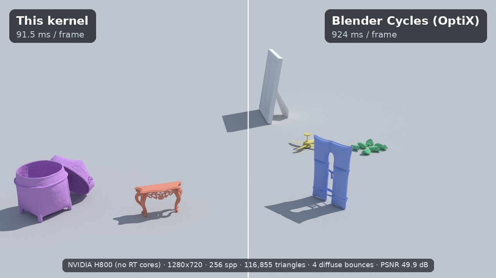
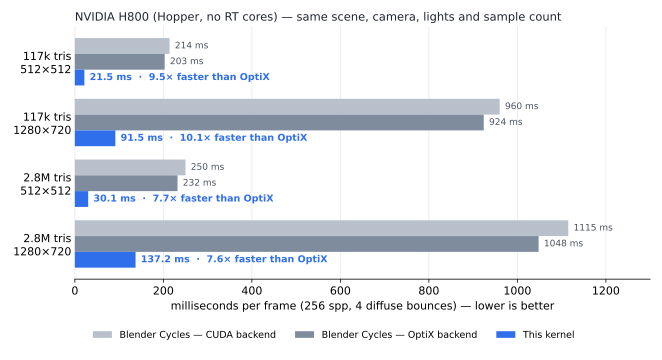
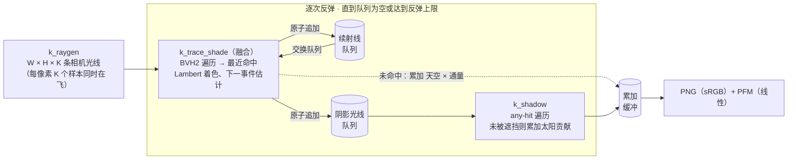
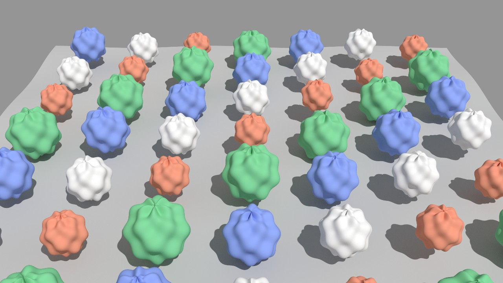
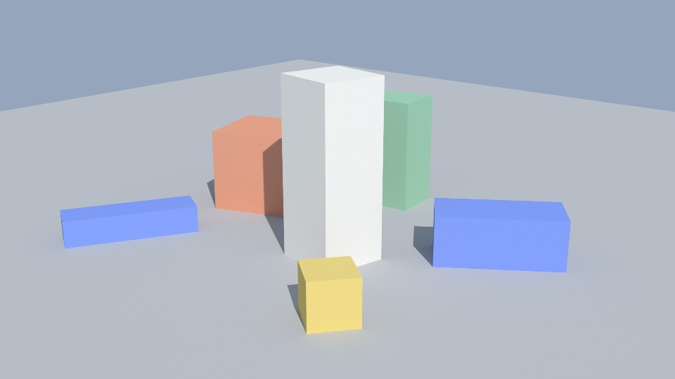

<div align="center">

# cuda-wavefront-pathtracer

**从零编写的 wavefront 路径追踪器，BVH 遍历全部跑在普通 CUDA 核心上。**<br>
为没有 RT 核心的 GPU 而写。在 NVIDIA H800 上渲染同一帧，**比 Blender Cycles 的 OptiX 后端快 7.6–10.1 倍**，<br>两者图像的 PSNR 为 49.9–50.9 dB。

[](https://developer.nvidia.com/cuda-toolkit)
[](#构建)
[-555)](#性能)
[](#为什么做这个)
[](LICENSE)

[English](README.md) · [简体中文](README.zh-CN.md)



<sub>左半边：本内核。右半边：Blender Cycles（OptiX）。网格、相机、太阳、天空与每像素 256 个样本完全相同。两个估计量一致，所以看不到接缝。</sub>

</div>

---

## 亮点

- **端到端约 85 亿条光线每秒**：H800 上 117k 三角形场景，512×512 为 8.5 G rays/s，720p 为 8.1 G rays/s。每条光线都真实遍历一棵 SAH BVH，全部在 CUDA 核心上完成。
- **Wavefront 架构**：一次 pass 中每个像素最多有 256 个样本同时在飞。路径状态存成结构数组，队列用原子追加压缩。
- **遍历与着色融合成一个内核**：同一线程遍历完立即着色，省掉命中缓冲的往返。仅这一项就带来 +29%。
- **与 Cycles 对照验证**：在对齐的配置下 PSNR 为 49.9–50.9 dB，图像均值相差约 0.3%。
- **小而无依赖**：约 1,200 行 CUDA 与 C++17，不依赖任何外部库，自带 OBJ/PLY 读取、BVH 构建和 PNG/PFM 输出。
- **完整的消融记录**：每次只改一项，测了 20 多个配置，变慢的也都记下来了。见[优化记录](#优化记录)。

## 为什么做这个

A100、H100、H800 这类数据中心 GPU 没有 RT 核心，OptiX 在这些卡上退化为软件遍历。我们实测 H800 上 Cycles 的 OptiX 后端只比它自己的 CUDA BVH2 内核快 0–8%。

所以问题是：专门写的内核单靠 CUDA 核心能榨出多少性能？在这类负载上，结果比通用生产渲染器高出约一个数量级。这样一来，原本闲着的机器学习 GPU 也能作为简单场景的路径追踪渲染节点。

## 性能

<p align="center"></p>

| 场景 | 分辨率 | 本内核 | Cycles OptiX | Cycles CUDA | 相对 OptiX 加速 | 对 Cycles 的 PSNR |
|---|---|---|---|---|---|---|
| 116,855 三角形 | 512×512 | **21.5 ms** · 8,506 Mrays/s | 203 ms · ≈897 Mrays/s | 214 ms | **9.5×** | 50.86 dB |
| 116,855 三角形 | 1280×720 | **91.5 ms** · 8,106 Mrays/s | 924 ms · ≈803 Mrays/s | 960 ms | **10.1×** | 49.93 dB |
| 2,804,474 三角形 | 512×512 | **30.1 ms** · 6,086 Mrays/s | 232 ms · ≈787 Mrays/s | 250 ms | **7.7×** | 50.85 dB |
| 2,804,474 三角形 | 1280×720 | **137.2 ms** · 5,407 Mrays/s | 1,048 ms · ≈708 Mrays/s | 1,115 ms | **7.6×** | 49.93 dB |

<details>
<summary><b>测量方法</b>（点击展开）</summary>

**软硬件**：NVIDIA H800 80 GB（Hopper，sm_90，无 RT 核心），驱动 535，CUDA 12.4，`nvcc -O3 --use_fast_math`；Blender 4.2.23 LTS。GPU 位于共享服务器上，每次测量时都有另一个租户约 20 GB 的空闲进程驻留。

**场景**：地面上放 6 个 [Poly Haven](https://polyhaven.com) 的 CC0 模型，共 116,855 个三角形。"2.8M" 版本把每个模型细分两级，形状不变。场景开阔、在户外，路径很浅，每个样本 2.7–3.1 条光线。场景文件不随本仓库发布。

**对齐的设置**：两个渲染器使用同一份导出的 PLY 网格、相机和逐材质反照率，只有 Lambert（Diffuse BSDF）材质，平直法线。光照为一盏 3.0 W/m² 的太阳加常数天空 (0.30, 0.38, 0.50)。都是 256 spp、4 次漫反射反弹，无俄罗斯轮盘、无钳制，1 px 盒式滤波，无降噪、无自适应采样。

**本内核计时**：一对 CUDA event 包住整帧，包括光线生成、全部反弹、着色、队列维护和主机同步；不含网格加载、BVH 构建与上传。先 8 spp 预热，再计时两帧 256 spp，表中取第一帧。配置为 `--variant bvh2 --tri woop --fuse 1 --batch 256`，以 `__launch_bounds__(128,12)` 编译。

**Cycles 计时**：在开启 persistent data 的第二次渲染上，用墙钟包住 `bpy.ops.render.render`，因此 Cycles 的 BVH 同样是复用的。这个时间包含 Blender 每帧的固定开销，在 512×512 下占比比 720p 大。

**每秒光线数**：本内核的 Mrays/s 是实测的主光线、续射线与阴影光线总数除以帧时间。Cycles 的是估计值：样本数乘以每样本光线数，后者来自同一路径逻辑在 CPU 上的回放，与本内核实测的光线数相差不到 0.6%。所以加速比一栏等同于帧时间之比。

**精度**：PSNR 在 8 bit sRGB 图像上计算（截断到 [0,1]、sRGB 传递函数、曝光 0），参照为 Cycles OptiX 的渲染结果。两者都是独立的 256 spp 蒙特卡洛估计，约 50 dB 已接近这种比较的噪声底。

</details>

> [!IMPORTANT]
> 这是一个专用内核，与通用生产渲染器在一个特意对齐的负载上比较。加速比说明的是专注的 wavefront 设计能从 CUDA 核心中榨出多少性能，并不意味着它能取代 Cycles。遇到带纹理或有光泽的材质、多光源、室内长路径时，差距会缩小。在**有** RT 核心的 GPU 上，硬件 OptiX 遍历应当远快于本仓库的任何实现；这一点我们没有测。

## 工作原理



- **BVH**：CPU 上的分箱 SAH 构建器（16 箱，叶子最多 4 个三角形）生成 BVH2。GPU 布局沿用 Aila & Laine（2009）的做法：每个 64 字节节点存两个子节点的包围盒。遍历用局部内存中 64 项的栈，先走较近的子节点。另外实现了 BVH4（128 B 节点）和压缩 8 叉 BVH（80 B 节点、8 bit 量化子包围盒，Ylitie 等 2017 的风格），在这个负载上都更慢。
- **三角形**：快速配置默认用 Woop 单位三角形变换，每个三角形按叶子顺序存 3 个 `float4`，先按 t 剔除。也可选 Möller–Trumbore。
- **着色**：Lambert BRDF，余弦加权续射线。太阳用下一事件估计在其视直径的锥内采样，逃逸的光线累加常数天空辐亮度。
- **Wavefront**：`--batch K` 每次 pass 发射 K·W·H 条路径。K = 1 时一帧 512×512 每次反弹只有 26 万条光线，远不够 H800 的 132 个 SM 吃。增大到 K = 64（1680 万条路径在飞）后 BVH2 吞吐提高 12–17 倍，一直到 K = 256 仍有收益。
- **可复现性**：随机数由 (像素, 样本, 深度, 维度, 种子) 的无状态哈希生成，每条路径都可复现。像素累加使用浮点原子操作。

## 优化记录

每一步只在当前最优配置上改一项。只有当四个基准行端到端 Mrays/s 的几何平均提升至少 3%，且对 Cycles 的 PSNR 不低于 49 dB 时才保留。

| 步骤 | 改动 | 效果 | 保留 |
|---|---|---|:-:|
| 1 | 每像素同时在飞的样本 K = 1 → 64 | 512×512 下 12–17 倍（BVH2） | ✅ |
| 2 | K = 64 → 128 | +6.0% | ✅ |
| 3 | **最近命中遍历与着色融合成一个内核** | **+28.8%** | ✅ |
| 4 | Woop 单位三角形测试替换 Möller–Trumbore（在融合内核上重测） | +3.1% | ✅ |
| 5 | `__launch_bounds__(128,12)`：最多 40 个寄存器，占用率 75% | +3.0% | ✅ |
| 6 | K = 128 → 256：整帧一个 wavefront pass | +4.8% | ✅ |
| — | 持久线程遍历内核 | 慢 2–8% | ❌ |
| — | 设备端驱动的反弹循环，无主机同步 | −7.9% | ❌ |
| — | 按方向八分区与起点 Morton 码把反弹光线排序进 32,768 个桶 | −30%：遍历最多快 2%，排序开销更大 | ❌ |
| — | BVH4（128 B 节点），在融合内核上 | −17.7% | ❌ |
| — | 压缩 8 叉 BVH | −19.3%：浅路径下解码 8 个子包围盒的计算开销超过节省的带宽 | ❌ |
| — | 在融合内核中直接追踪阴影光线，不用阴影队列 | −9.1%：一个线程串行做两次遍历，warp 发散加重 | ❌ |
| — | 叶子最多 2 个三角形 | +1.7% | ❌ |
| — | 叶子最多 8 个三角形 | −7.2% | ❌ |
| — | 最多 32 个寄存器（占用率 100%，有溢出） | −2% 到 −26% | ❌ |

步骤 2–6 合起来比 K = 64、遍历与着色分开、Möller–Trumbore 三角形的基线快 1.43–1.58 倍。而这个基线本身已经比 Cycles OptiX 快 4.9–6.5 倍。

## 构建

需要 CUDA 工具包（nvcc）和支持 C++17 的主机编译器。构建不需要 GPU。

```bash
git clone https://github.com/YJLi-new/cuda-wavefront-pathtracer.git
```

```bash
cd cuda-wavefront-pathtracer && ./build.sh
```

默认目标为 `sm_90`。其他 GPU 请设置 `ARCH`，例如 A100 用 `ARCH=sm_80 ./build.sh`，RTX 40 系列用 `ARCH=sm_89 ./build.sh`。只有 sm_90 经过调优和测试。`VARIANTS=1 ./build.sh` 会额外构建消融中用到的寄存器上限变体。

## 运行

内置合成场景约 200 万个三角形：一块地面加 7×7 个凹凸球。

```bash
./build/pt --synthetic 7 --width 1280 --height 720 --spp 256 --bounces 4 --variant bvh2 --tri woop --fuse 1 --batch 64 --out out/synthetic
```

<p align="center"></p>

渲染自己的网格。示例场景在 `examples/` 中：

```bash
./build/pt --mesh examples/boxes.obj --camera examples/camera.json --lighting examples/lighting.json --width 960 --height 540 --spp 256 --bounces 4 --tri woop --fuse 1 --batch 64 --out out/boxes
```

<p align="center"></p>

在 512×512 与 1280×720 下跑基准预设：

```bash
BATCH=64 scripts/bench_synthetic.sh
```

每次运行向标准输出打印一行 JSON，包含光线数、`t_frame_ms`、`t_trace_ms`、`mrays_s_e2e`、`mrays_s_trace`、BVH 统计和显存占用；并写出 `<out>.png`（sRGB、曝光 0、截断）和 `<out>.pfm`（线性辐亮度）。比较两张渲染图可用 `python tools/psnr.py a.png b.png`，需要 numpy 和 Pillow。

> [!TIP]
> **显存**：每条在飞的路径约需 128 字节，所以显存约为 128 × 宽 × 高 × batch 字节，再加上场景。720p 下 `--batch 64` 约 7 GB，128 约 14 GB，256 约 29 GB。在 GPU 吃满之前，batch 越大越快。`--spp` 必须是 `--batch` 的整数倍。

### 命令行参数

| 参数 | 默认值 | 含义 |
|---|---|---|
| `--mesh PATH` | — | `.obj`（读 `.mtl` 中的 `Kd` 颜色，可选 `vn` 法线）或 `.ply`（ASCII 或二进制小端，可选 `nx ny nz`，可选逐面 `material_index`） |
| `--synthetic N` | 0 | 内置场景，N×N 个球，每个约 4 万三角形。替代 `--mesh` 和 `--camera`。 |
| `--camera PATH` | — | 相机 JSON，格式见下 |
| `--c2w "m00,m01,…,m33"` | — | 直接给出相机到世界矩阵：16 个数，行优先 |
| `--c2w_key KEY` / `--frame I` | `c2w_blender_zup` / 0 | 使用相机 JSON 中的哪个矩阵。该键可以是单个矩阵，也可以是逐帧矩阵列表。 |
| `--width`、`--height` | 512、512 | 图像尺寸 |
| `--hfov DEG` / `--fx`、`--fy` | 50° | 水平视场角，或以像素为单位的焦距 |
| `--spp N` | 256 | 每像素样本数 |
| `--batch K` | 64 | 每次 wavefront pass 中每像素同时在飞的样本数 |
| `--bounces N` | 8 | 间接漫反射反弹次数，相机命中为第 0 层 |
| `--variant bvh2\|bvh4\|bvh8` | bvh2 | BVH 布局 |
| `--tri mt\|woop` | mt | 三角形求交方法，`woop` 更快 |
| `--fuse 0\|1\|2` | 0 | 1 表示遍历与着色融合，最快；2 表示还在内核中直接追踪阴影光线 |
| `--leaf N` | 4 | BVH 叶子最多三角形数 |
| `--lighting PATH` | — | 光照 JSON，格式见下 |
| `--sun_to X Y Z` | 0.3 −0.5 0.8 | **指向**太阳的方向，世界 z 朝上 |
| `--sun_rgb R G B` | 3 3 3 | 垂直于太阳的表面上的辐照度，W/m² |
| `--sun_angle DEG` | 0.526 | 太阳视直径 |
| `--sky R G B` | 0.3 0.3 0.3 | 常数天空辐亮度 |
| `--albedo R G B` | — | 覆盖所有材质的反照率 |
| `--filter bh\|box` | bh | 像素滤波：Blackman–Harris 1.5 px（同 Cycles）或 1 px 盒式 |
| `--smooth 0\|1` | 1 | 网格有顶点法线时使用 |
| `--yup_to_zup 0\|1` | 0 | 把 y 朝上的网格转换为 z 朝上 |
| `--eps S` | 1e-4 | 光线起点偏移，按场景尺度的比例 |
| `--near D` | 0 | 相机光线的近裁剪距离 |
| `--seed`、`--warm`、`--reps` | 1000、8、1 | 随机种子、预热 spp、计时帧数 |
| `--persistent`、`--devloop`、`--sort` | 0 | 消融中的实验变体，都更慢 |
| `--out PREFIX` | out | 输出路径前缀 |

### 输入格式

**相机**：世界坐标 z 朝上。相机使用 OpenGL 约定：沿自身 −Z 方向看，+Y 朝上。`c2w` 为行优先的 4×4 矩阵。若 `width` 和 `height` 与请求的分辨率一致，则使用 `fx`、`fy`；否则改用 `hfov_deg`，而 `hfov_deg` 只在存在 `fx` 时才会被读取。

```json
{ "width": 960, "height": 540, "fx": 1158.823, "fy": 1158.823, "hfov_deg": 45.0,
  "c2w_blender_zup": [0.759, -0.201, 0.619, 9.0,  0.651, 0.235, -0.722, -10.5,  0.0, 0.951, 0.309, 5.5,  0, 0, 0, 1] }
```

**光照**：所有键都可选。

```json
{ "sun_dir_to_light_world_zup": [0.609, -0.426, 0.669],
  "sun_irradiance_W_m2": 3.0,
  "sun_angle_rad": 0.00918,
  "sky_radiance_rgb_linear": [0.30, 0.38, 0.50],
  "albedo_rgb_linear_by_material_index": [[0.5, 0.5, 0.5], [0.8, 0.35, 0.22]] }
```

若提供 `albedo_rgb_linear_by_material_index`，它会替换网格自带的材质颜色，按 OBJ 材质顺序或 PLY 的 `material_index` 索引。

## 局限

- **材质**：只有 Lambert，每个材质一个反照率。没有纹理，也没有光泽、镜面或透射 BSDF。
- **光源**：一个太阳加常数天空。没有环境贴图重要性采样，也没有面光源、点光源或自发光。
- **采样**：没有俄罗斯轮盘、自适应采样或降噪。
- **几何**：只支持静态三角网格。BVH 在启动时由 CPU 单线程构建，这部分不计入帧时间。
- **可移植性**：可以为 nvcc 支持的任何架构编译，但只在 Hopper（sm_90）上调优和验证过。
- **加速比的适用范围**：只在一个开阔户外、浅路径、纯漫反射材质的场景上测过。见[性能](#性能)下的说明。

## 目录结构

```
src/main.cu       内核（光线生成、融合遍历着色、着色、阴影）与主机驱动
src/bvh.h         分箱 SAH BVH2 构建器；BVH2 与 BVH4 的 GPU 布局；三角形打包
src/bvh8.h        压缩 8 叉 BVH 与 Woop 三角形打包
src/mesh.h        OBJ/MTL 与 PLY 读取；合成场景生成
src/vec.h         float3 工具函数
src/png.h         最小化的 PNG 与 PFM 写出
tools/psnr.py     在色调映射后的 sRGB 上算 PSNR（支持 PNG、PFM、EXR）
scripts/          基准预设
examples/         小型 OBJ 示例场景及相机、光照 JSON
build.sh          构建脚本（ARCH、VARIANTS）
```

## 致谢

遍历方式与数据布局参考了以下工作：

- T. Aila, S. Laine. *Understanding the Efficiency of Ray Traversal on GPUs*. HPG 2009.
- S. Laine, T. Karras, T. Aila. *Megakernels Considered Harmful: Wavefront Path Tracing on GPUs*. HPG 2013.
- H. Ylitie, T. Karras, S. Laine. *Efficient Incoherent Ray Traversal on GPUs Through Compressed Wide BVHs*. HPG 2017.
- S. Woop. *A Ray Tracing Hardware Architecture for Dynamic Scenes*. 2004（单位三角形求交）。
- T. Möller, B. Trumbore. *Fast, Minimum Storage Ray/Triangle Intersection*. JGT 1997.
- T. Duff 等. *Building an Orthonormal Basis, Revisited*. JCGT 2017.

基准场景使用了 [Poly Haven](https://polyhaven.com) 的 CC0 模型，参考图由 [Blender Cycles](https://www.cycles-renderer.org/) 渲染。本项目在 Claude（Anthropic）的协助下开发。

## 许可证

[MIT](LICENSE)
